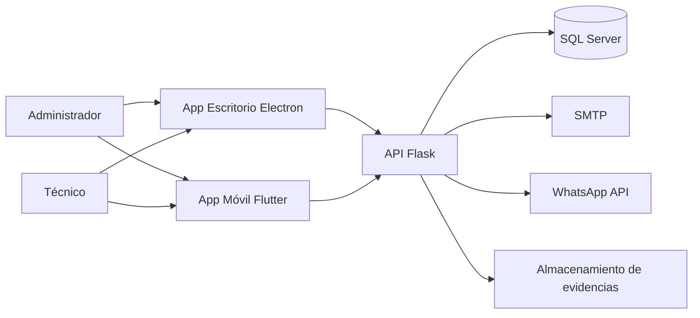
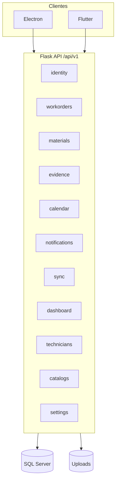

# Arquitectura — SIGOS 2.0

**Proyecto:** SIGOS 2.0
**Versión del documento:** 1.0
**Fecha:** 06/11/2026
**Autor:** [PENDIENTE]

## 1. Vista de contexto (C4 nivel 1)

### Actores y sistemas externos

| Actor / Elemento | Tipo / Rol | Descripción de la interacción |
|---|---|---|
| Administrador | Usuario (rol `admin`) | Gestiona usuarios, órdenes, materiales, configuración (`services/api/seed.py`, `app/identity`) |
| Despachador | Usuario (rol `dispatcher`) | Crea y asigna órdenes |
| Técnico | Usuario (rol `technician`) | Ejecuta órdenes, consume materiales, sube evidencias (`app/evidence`, `app/materials`) |
| App de escritorio | Contenedor Electron | Consume API REST vía `SIGOS_API_BASE_URL` (`apps/desktop/src/main/index.js`, `src/renderer/app.js`) |
| App móvil | Contenedor Flutter | Consume API REST; sincronización offline (`apps/mobile/lib/core/sync/sync_service.dart`) |
| SQL Server | Sistema externo (BD) | Persistencia principal (`services/api/app/config.py`) |
| SMTP | Sistema externo (correo) | Envío de notificaciones (`app/notifications/senders.py`) |
| WhatsApp API | Sistema externo | Envío de notificaciones (`app/notifications/senders.py`) |
| Almacenamiento de archivos | Sistema externo (disco/volumen) | Evidencias (`app/evidence/storage.py`, `UPLOAD_DIR`) |

## 2. Contenedores y componentes (C4 nivel 2)

### Frontend / Clientes

| Contenedor | Tecnología | Responsabilidad | Carpeta |
|---|---|---|---|
| Escritorio | Electron + JS/HTML/CSS | UI de gestión, calendario, evidencias | `apps/desktop/` |
| Móvil | Flutter + Dart | UI móvil, offline, sync | `apps/mobile/` |

### Backend

| Componente | Carpeta | Responsabilidad |
|---|---|---|
| App factory | `services/api/app/__init__.py` | Registra blueprints bajo `/api/v1` |
| Identidad | `app/identity/` | Login, JWT, usuarios, roles, audit |
| Órdenes | `app/workorders/` | CRUD, estados, historial, programación, asignación |
| Materiales | `app/materials/` | Catálogo, stock, movimientos, transferencias, solicitudes |
| Evidencias | `app/evidence/` | Subida, revisión, firmas, checklist, eventos |
| Calendario | `app/calendar/` | Eventos, disponibilidad, validación |
| Notificaciones | `app/notifications/` | Cola y envío (email/WhatsApp) |
| Sincronización | `app/sync/` | Push/pull offline |
| Dashboard | `app/dashboard/` | Resúmenes |
| Técnicos | `app/technicians/` | Perfiles, disponibilidad, activación |
| Catálogos | `app/catalogs/` | Países, ciudades, zonas, especialidades, tipos de instalación, sectores |
| Configuración | `app/settings/` | Organización, operaciones, seguridad, notificaciones, audit log |

### Base de datos

| Elemento | Detalle |
|---|---|
| Motor | Microsoft SQL Server 2022+ (`infra/docker/compose.yaml`) |
| ORM | Flask-SQLAlchemy 3.1.1 |
| Migraciones | Alembic/Flask-Migrate (`services/api/migrations/`) |
| Tablas | 41 (introspección SQLAlchemy) |

## 3. Registros de decisiones de arquitectura (ADR)

| ID ADR | Decisión tecnológica | Justificación / Beneficios | Alternativas descartadas | Estatus |
|---|---|---|---|---|
| ADR-01 | Backend Flask | Evidencia: `services/api/requirements.txt`, `app/__init__.py` | [PENDIENTE: confirmar motivo con el equipo] | Por confirmar |
| ADR-02 | SQL Server como BD | Evidencia: `README.md`, `infra/docker/compose.yaml`, `config.py` | [PENDIENTE: confirmar motivo con el equipo] | Por confirmar |
| ADR-03 | JWT para autenticación | Evidencia: `app/identity/tokens.py`, `config.py` (expiración 15 min / 7 días) | [PENDIENTE: confirmar motivo con el equipo] | Por confirmar |
| ADR-04 | Electron para escritorio | Evidencia: `apps/desktop/package.json` | [PENDIENTE: confirmar motivo con el equipo] | Por confirmar |
| ADR-05 | Flutter para móvil | Evidencia: `apps/mobile/pubspec.yaml` | [PENDIENTE: confirmar motivo con el equipo] | Por confirmar |
| ADR-06 | Alembic para migraciones | Evidencia: `services/api/migrations/`, `extensions.py` | [PENDIENTE: confirmar motivo con el equipo] | Por confirmar |
| ADR-07 | Almacenamiento local de evidencias (`UPLOAD_DIR`) | Evidencia: `app/evidence/storage.py`, `config_prod.py` | [PENDIENTE: confirmar motivo con el equipo] | Por confirmar |
