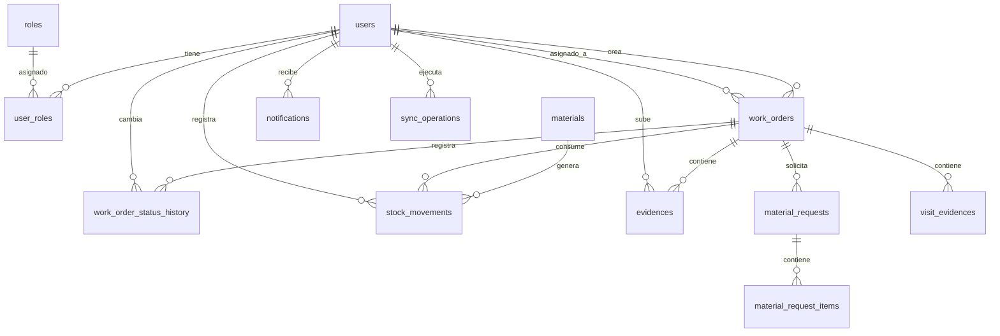

# Diseño detallado — SIGOS 2.0

**Proyecto:** SIGOS 2.0
**Versión del documento:** 1.0
**Fecha:** 06/11/2026
**Autor:** [PENDIENTE]

## 1. Modelo entidad-relación

Fuente: introspección de SQLAlchemy (`services/api/app/*/models.py`) ejecutada con `TestConfig`. 41 tablas.

A continuación, una tabla por entidad con campos, tipos y restricciones.

PY### audit_events

| Campo | Tipo y restricciones |
|---|---|
| id | INTEGER PK NOT NULL |
| actor_id | INTEGER  FK->users.id |
| target_user_id | INTEGER  FK->users.id |
| action | VARCHAR(40) NOT NULL |
| changes | TEXT |
| created_at | DATETIME DEFAULT CallableColumnDefault(<function AuditEvent.<lambda> at 0x00000209BD0FA8E0>) |

### audit_log

| Campo | Tipo y restricciones |
|---|---|
| id | INTEGER PK NOT NULL |
| created_at | DATETIME DEFAULT CallableColumnDefault(<function AuditLog.<lambda> at 0x00000209BD310180>) |
| user_id | INTEGER  FK->users.id |
| section | VARCHAR(40) NOT NULL |
| field | VARCHAR(80) |
| old_value | TEXT |
| new_value | TEXT |
| result | VARCHAR(20) NOT NULL DEFAULT ScalarElementColumnDefault('applied') |
| request_id | VARCHAR(40) |
| username | VARCHAR(80) |

Indices: INDEX ix_audit_log_section: ['section'] unique=False; INDEX ix_audit_log_section_created: ['section', 'created_at'] unique=False; INDEX ix_audit_log_created_at: ['created_at'] unique=False

### cities

| Campo | Tipo y restricciones |
|---|---|
| id | INTEGER PK NOT NULL |
| country_id | INTEGER NOT NULL FK->countries.id |
| department_name | VARCHAR(120) |
| dane_code | VARCHAR(5) NOT NULL |
| name | VARCHAR(120) NOT NULL |
| name_norm | VARCHAR(120) NOT NULL |
| active | BOOLEAN NOT NULL DEFAULT ScalarElementColumnDefault(True) |

Indices: INDEX ix_city_country_name_norm: ['country_id', 'name_norm'] unique=False; INDEX ix_cities_country_id: ['country_id'] unique=False

### countries

| Campo | Tipo y restricciones |
|---|---|
| id | INTEGER PK NOT NULL |
| iso2 | VARCHAR(2) UK NOT NULL |
| name | VARCHAR(120) NOT NULL |
| name_norm | VARCHAR(120) UK NOT NULL |
| active | BOOLEAN NOT NULL DEFAULT ScalarElementColumnDefault(True) |

### departments

| Campo | Tipo y restricciones |
|---|---|
| code | VARCHAR(2) PK NOT NULL |
| name | VARCHAR(120) NOT NULL |
| name_norm | VARCHAR(120) |

### evidence_events

| Campo | Tipo y restricciones |
|---|---|
| id | INTEGER PK NOT NULL |
| work_order_id | INTEGER  FK->work_orders.id |
| evidence_id | INTEGER  FK->visit_evidences.id |
| actor_id | INTEGER  FK->users.id |
| action | VARCHAR(40) NOT NULL |
| from_status | VARCHAR(30) |
| to_status | VARCHAR(30) |
| details | TEXT |
| created_at | DATETIME DEFAULT CallableColumnDefault(<function EvidenceEvent.<lambda> at 0x00000209BD3CEF20>) |

Indices: INDEX ix_evidence_events_work_order_id: ['work_order_id'] unique=False; INDEX ix_evidence_events_evidence_id: ['evidence_id'] unique=False; INDEX ix_evidence_events_created_at: ['created_at'] unique=False

### evidence_reviews

| Campo | Tipo y restricciones |
|---|---|
| id | INTEGER PK NOT NULL |
| evidence_id | INTEGER NOT NULL FK->visit_evidences.id |
| reviewer_id | INTEGER NOT NULL FK->users.id |
| decision | VARCHAR(30) NOT NULL |
| notes | TEXT |
| created_at | DATETIME DEFAULT CallableColumnDefault(<function EvidenceReview.<lambda> at 0x00000209BD3CDBC0>) |

Indices: INDEX ix_evidence_reviews_evidence_id: ['evidence_id'] unique=False

### installation_types

| Campo | Tipo y restricciones |
|---|---|
| code | VARCHAR(60) PK NOT NULL |
| label | VARCHAR(120) NOT NULL |
| name_norm | VARCHAR(120) UK NOT NULL |
| active | BOOLEAN NOT NULL DEFAULT ScalarElementColumnDefault(True) |

### material_catalog

| Campo | Tipo y restricciones |
|---|---|
| id | INTEGER PK NOT NULL |
| category_id | INTEGER NOT NULL FK->material_categories.id |
| code | VARCHAR(40) UK NOT NULL |
| name | VARCHAR(200) NOT NULL |
| name_norm | VARCHAR(200) UK NOT NULL |
| unit_id | INTEGER NOT NULL FK->material_units.id |
| measure | VARCHAR(60) |
| stage | VARCHAR(60) |
| applies_to | VARCHAR(40) |
| is_active | BOOLEAN NOT NULL DEFAULT ScalarElementColumnDefault(True) |

Indices: INDEX ix_material_catalog_unit_id: ['unit_id'] unique=False; INDEX ix_material_catalog_name_norm: ['name_norm'] unique=True; INDEX ix_material_catalog_category_id: ['category_id'] unique=False; INDEX ix_material_catalog_code: ['code'] unique=True

### material_categories

| Campo | Tipo y restricciones |
|---|---|
| id | INTEGER PK NOT NULL |
| code | VARCHAR(40) UK NOT NULL |
| name | VARCHAR(120) NOT NULL |
| name_norm | VARCHAR(120) UK NOT NULL |
| is_active | BOOLEAN NOT NULL DEFAULT ScalarElementColumnDefault(True) |

Indices: INDEX ix_material_categories_code: ['code'] unique=True; INDEX ix_material_categories_name_norm: ['name_norm'] unique=True

### material_request_deliveries

| Campo | Tipo y restricciones |
|---|---|
| id | INTEGER PK NOT NULL |
| request_id | INTEGER NOT NULL FK->material_requests.id |
| actor_id | INTEGER NOT NULL FK->users.id |
| operation_id | VARCHAR(36) |
| created_at | DATETIME DEFAULT CallableColumnDefault(<function MaterialRequestDelivery.<lambda> at 0x00000209BD22A840>) |

Indices: INDEX ix_material_request_deliveries_created_at: ['created_at'] unique=False; INDEX ix_material_request_deliveries_request_id: ['request_id'] unique=False; INDEX ix_material_request_deliveries_operation_id: ['operation_id'] unique=False

### material_request_delivery_items

| Campo | Tipo y restricciones |
|---|---|
| id | INTEGER PK NOT NULL |
| delivery_id | INTEGER NOT NULL FK->material_request_deliveries.id |
| request_item_id | INTEGER NOT NULL FK->material_request_items.id |
| quantity_delivered | FLOAT NOT NULL |
| movement_id | INTEGER  FK->stock_movements.id |

Indices: INDEX ix_material_request_delivery_items_request_item_id: ['request_item_id'] unique=False; INDEX ix_material_request_delivery_items_delivery_id: ['delivery_id'] unique=False

### material_request_events

| Campo | Tipo y restricciones |
|---|---|
| id | INTEGER PK NOT NULL |
| request_id | INTEGER NOT NULL FK->material_requests.id |
| actor_id | INTEGER  FK->users.id |
| action | VARCHAR(40) NOT NULL |
| from_status | VARCHAR(30) |
| to_status | VARCHAR(30) |
| payload | TEXT |
| created_at | DATETIME DEFAULT CallableColumnDefault(<function MaterialRequestEvent.<lambda> at 0x00000209BD229440>) |

Indices: INDEX ix_material_request_events_created_at: ['created_at'] unique=False; INDEX ix_material_request_events_request_id: ['request_id'] unique=False

### material_request_items

| Campo | Tipo y restricciones |
|---|---|
| id | INTEGER PK NOT NULL |
| request_id | INTEGER NOT NULL FK->material_requests.id |
| material_id | INTEGER NOT NULL FK->materials.id |
| quantity | FLOAT NOT NULL DEFAULT ScalarElementColumnDefault(0) |
| quantity_requested | FLOAT NOT NULL DEFAULT ScalarElementColumnDefault(0) |
| quantity_approved | FLOAT NOT NULL DEFAULT ScalarElementColumnDefault(0) |
| quantity_delivered | FLOAT NOT NULL DEFAULT ScalarElementColumnDefault(0) |

Indices: INDEX ix_material_request_items_request_id: ['request_id'] unique=False; INDEX ix_material_request_items_material_id: ['material_id'] unique=False

### material_request_operations

| Campo | Tipo y restricciones |
|---|---|
| id | INTEGER PK NOT NULL |
| operation_id | VARCHAR(36) UK NOT NULL |
| operation_type | VARCHAR(40) NOT NULL |
| actor_id | INTEGER  FK->users.id |
| request_id | INTEGER  FK->material_requests.id |
| result | TEXT |
| created_at | DATETIME DEFAULT CallableColumnDefault(<function MaterialRequestOperation.<lambda> at 0x00000209BD24D120>) |

Indices: INDEX ix_material_request_operations_request_id: ['request_id'] unique=False; INDEX ix_material_request_operations_created_at: ['created_at'] unique=False; INDEX ix_material_request_operations_operation_id: ['operation_id'] unique=True; INDEX ix_material_request_operations_operation_type: ['operation_type'] unique=False

### material_requests

| Campo | Tipo y restricciones |
|---|---|
| id | INTEGER PK NOT NULL |
| requester_id | INTEGER NOT NULL FK->users.id |
| technician_id | INTEGER  FK->technician_profiles.id |
| work_order_id | INTEGER  FK->work_orders.id |
| status | VARCHAR(30) NOT NULL DEFAULT ScalarElementColumnDefault('SUBMITTED') |
| client_operation_id | VARCHAR(36) UK |
| delivered_by_id | INTEGER  FK->users.id |
| reason | TEXT |
| approved_by_id | INTEGER  FK->users.id |
| approval_reason | TEXT |
| created_at | DATETIME DEFAULT CallableColumnDefault(<function MaterialRequest.<lambda> at 0x00000209BD1D84A0>) |
| updated_at | DATETIME DEFAULT CallableColumnDefault(<function MaterialRequest.<lambda> at 0x00000209BD1D8680>) |

Indices: INDEX ix_material_requests_requester_id: ['requester_id'] unique=False; INDEX ix_material_requests_client_operation_id: ['client_operation_id'] unique=True; INDEX ix_material_requests_work_order_id: ['work_order_id'] unique=False; INDEX ix_material_requests_technician_id: ['technician_id'] unique=False

### material_units

| Campo | Tipo y restricciones |
|---|---|
| id | INTEGER PK NOT NULL |
| code | VARCHAR(20) UK NOT NULL |
| name | VARCHAR(60) NOT NULL |
| name_norm | VARCHAR(60) UK NOT NULL |
| allows_decimal | BOOLEAN NOT NULL DEFAULT ScalarElementColumnDefault(False) |
| is_active | BOOLEAN NOT NULL DEFAULT ScalarElementColumnDefault(True) |

Indices: INDEX ix_material_units_code: ['code'] unique=True; INDEX ix_material_units_name_norm: ['name_norm'] unique=True

### materials

| Campo | Tipo y restricciones |
|---|---|
| id | INTEGER PK NOT NULL |
| name | VARCHAR(120) NOT NULL |
| code | VARCHAR(40) UK |
| description | VARCHAR(250) |
| unit | VARCHAR(20) NOT NULL |
| current_stock | FLOAT NOT NULL DEFAULT ScalarElementColumnDefault(0) |
| min_stock | FLOAT NOT NULL DEFAULT ScalarElementColumnDefault(0) |
| unit_price | NUMERIC(18, 2) NOT NULL DEFAULT ScalarElementColumnDefault(0) |
| is_active | BOOLEAN NOT NULL DEFAULT ScalarElementColumnDefault(True) |
| catalog_item_id | INTEGER UK FK->material_catalog.id |
| created_at | DATETIME DEFAULT CallableColumnDefault(<function Material.<lambda> at 0x00000209BD177100>) |
| updated_at | DATETIME DEFAULT CallableColumnDefault(<function Material.<lambda> at 0x00000209BD1772E0>) |

Indices: INDEX ix_materials_code: ['code'] unique=True; INDEX ix_materials_catalog_item_id: ['catalog_item_id'] unique=True; INDEX ix_materials_name: ['name'] unique=False

### municipalities

| Campo | Tipo y restricciones |
|---|---|
| code | VARCHAR(5) PK NOT NULL |
| name | VARCHAR(120) NOT NULL |
| name_norm | VARCHAR(120) |
| department_code | VARCHAR(2)  FK->departments.code |

Indices: INDEX ix_municipalities_department_code: ['department_code'] unique=False

### notification_settings

| Campo | Tipo y restricciones |
|---|---|
| id | INTEGER PK NOT NULL |
| preferences | TEXT NOT NULL DEFAULT ScalarElementColumnDefault('{}') |
| version | INTEGER NOT NULL DEFAULT ScalarElementColumnDefault(0) |
| updated_by_id | INTEGER  FK->users.id |
| updated_at | DATETIME DEFAULT CallableColumnDefault(<function NotificationSettings.<lambda> at 0x00000209BD2E2660>) |

### notifications

| Campo | Tipo y restricciones |
|---|---|
| id | INTEGER PK NOT NULL |
| user_id | INTEGER NOT NULL FK->users.id |
| channel | VARCHAR(15) NOT NULL |
| recipient | VARCHAR(250) NOT NULL |
| subject | VARCHAR(200) |
| message | TEXT NOT NULL |
| status | VARCHAR(15) NOT NULL DEFAULT ScalarElementColumnDefault('pending') |
| retry_count | INTEGER NOT NULL DEFAULT ScalarElementColumnDefault(0) |
| error_message | VARCHAR(500) |
| created_at | DATETIME DEFAULT CallableColumnDefault(<function Notification.<lambda> at 0x00000209BD4DDEE0>) |
| sent_at | DATETIME |

Indices: INDEX ix_notifications_status: ['status'] unique=False; INDEX ix_notifications_user_id: ['user_id'] unique=False

### operational_settings

| Campo | Tipo y restricciones |
|---|---|
| id | INTEGER PK NOT NULL |
| work_days | VARCHAR(20) NOT NULL DEFAULT ScalarElementColumnDefault('1,2,3,4,5') |
| work_start | VARCHAR(5) NOT NULL DEFAULT ScalarElementColumnDefault('07:00') |
| work_end | VARCHAR(5) NOT NULL DEFAULT ScalarElementColumnDefault('18:00') |
| default_visit_duration | INTEGER NOT NULL DEFAULT ScalarElementColumnDefault(60) |
| max_visit_duration | INTEGER NOT NULL DEFAULT ScalarElementColumnDefault(480) |
| min_advance_hours | INTEGER NOT NULL DEFAULT ScalarElementColumnDefault(0) |
| travel_margin_minutes | INTEGER NOT NULL DEFAULT ScalarElementColumnDefault(0) |
| calendar_interval | INTEGER NOT NULL DEFAULT ScalarElementColumnDefault(30) |
| stock_critical_threshold | FLOAT NOT NULL DEFAULT ScalarElementColumnDefault(0.5) |
| version | INTEGER NOT NULL DEFAULT ScalarElementColumnDefault(0) |
| updated_by_id | INTEGER  FK->users.id |
| updated_at | DATETIME DEFAULT CallableColumnDefault(<function OperationalSettings.<lambda> at 0x00000209BD2E0360>) |

### organization_settings

| Campo | Tipo y restricciones |
|---|---|
| id | INTEGER PK NOT NULL |
| company_name | VARCHAR(150) NOT NULL DEFAULT ScalarElementColumnDefault('SIGOS') |
| nit | VARCHAR(40) |
| admin_email | VARCHAR(120) NOT NULL DEFAULT ScalarElementColumnDefault('admin@sigos.local') |
| contact_phone | VARCHAR(30) |
| address | VARCHAR(250) |
| city_id | INTEGER  FK->cities.id |
| timezone | VARCHAR(60) NOT NULL DEFAULT ScalarElementColumnDefault('America/Bogota') |
| version | INTEGER NOT NULL DEFAULT ScalarElementColumnDefault(0) |
| updated_by_id | INTEGER  FK->users.id |
| updated_at | DATETIME DEFAULT CallableColumnDefault(<function OrganizationSettings.<lambda> at 0x00000209BD2AEFC0>) |

### roles

| Campo | Tipo y restricciones |
|---|---|
| id | INTEGER PK NOT NULL |
| name | VARCHAR(50) UK NOT NULL |
| description | VARCHAR(200) |

Indices: INDEX ix_roles_name: ['name'] unique=True

### sectors

| Campo | Tipo y restricciones |
|---|---|
| id | INTEGER PK NOT NULL |
| municipality_code | VARCHAR(5)  FK->municipalities.code |
| name | VARCHAR(120) NOT NULL |
| name_norm | VARCHAR(120) |
| kind | VARCHAR(30) NOT NULL DEFAULT ScalarElementColumnDefault('sector') |
| active | BOOLEAN NOT NULL DEFAULT ScalarElementColumnDefault(True) |

Indices: INDEX ix_sectors_municipality_code: ['municipality_code'] unique=False

### security_settings

| Campo | Tipo y restricciones |
|---|---|
| id | INTEGER PK NOT NULL |
| session_inactivity_minutes | INTEGER NOT NULL DEFAULT ScalarElementColumnDefault(30) |
| session_max_hours | INTEGER NOT NULL DEFAULT ScalarElementColumnDefault(8) |
| password_min_length | INTEGER NOT NULL DEFAULT ScalarElementColumnDefault(10) |
| password_history_count | INTEGER NOT NULL DEFAULT ScalarElementColumnDefault(3) |
| lock_attempts | INTEGER NOT NULL DEFAULT ScalarElementColumnDefault(5) |
| lock_minutes | INTEGER NOT NULL DEFAULT ScalarElementColumnDefault(15) |
| temp_password_validity_days | INTEGER NOT NULL DEFAULT ScalarElementColumnDefault(7) |
| version | INTEGER NOT NULL DEFAULT ScalarElementColumnDefault(0) |
| updated_by_id | INTEGER  FK->users.id |
| updated_at | DATETIME DEFAULT CallableColumnDefault(<function SecuritySettings.<lambda> at 0x00000209BD2E1580>) |

### specialties

| Campo | Tipo y restricciones |
|---|---|
| code | VARCHAR(60) PK NOT NULL |
| label | VARCHAR(120) NOT NULL |
| name_norm | VARCHAR(120) UK NOT NULL |
| active | BOOLEAN NOT NULL DEFAULT ScalarElementColumnDefault(True) |

### stock_movements

| Campo | Tipo y restricciones |
|---|---|
| id | INTEGER PK NOT NULL |
| material_id | INTEGER NOT NULL FK->materials.id |
| quantity | FLOAT NOT NULL DEFAULT ScalarElementColumnDefault(0) |
| quantity_requested | FLOAT NOT NULL DEFAULT ScalarElementColumnDefault(0) |
| quantity_approved | FLOAT NOT NULL DEFAULT ScalarElementColumnDefault(0) |
| quantity_delivered | FLOAT NOT NULL DEFAULT ScalarElementColumnDefault(0) |
| movement_type | VARCHAR(15) NOT NULL |
| work_order_id | INTEGER  FK->work_orders.id |
| user_id | INTEGER NOT NULL FK->users.id |
| notes | VARCHAR(250) |
| created_at | DATETIME DEFAULT CallableColumnDefault(<function StockMovement.<lambda> at 0x00000209BD1B1120>) |

Indices: INDEX ix_stock_movements_material_id: ['material_id'] unique=False

### sync_operations

| Campo | Tipo y restricciones |
|---|---|
| id | INTEGER PK NOT NULL |
| client_operation_id | VARCHAR(36) UK NOT NULL |
| operation_type | VARCHAR(50) NOT NULL |
| payload | TEXT NOT NULL |
| user_id | INTEGER NOT NULL FK->users.id |
| status | VARCHAR(15) NOT NULL DEFAULT ScalarElementColumnDefault('pending') |
| result | TEXT |
| created_at | DATETIME DEFAULT CallableColumnDefault(<function SyncOperation.<lambda> at 0x00000209BD4DC4A0>) |
| synced_at | DATETIME |

Indices: INDEX ix_sync_operations_status: ['status'] unique=False; INDEX ix_sync_operations_client_operation_id: ['client_operation_id'] unique=True

### technician_profiles

| Campo | Tipo y restricciones |
|---|---|
| id | INTEGER PK NOT NULL |
| user_id | INTEGER UK NOT NULL FK->users.id |
| first_name | VARCHAR(80) |
| last_name | VARCHAR(80) |
| phone | VARCHAR(30) |
| email | VARCHAR(120) |
| specialty | VARCHAR(80) |
| specialty_code | VARCHAR(60)  FK->specialties.code |
| legacy_zone | VARCHAR(250) |
| document_type | VARCHAR(20) |
| document_number | VARCHAR(40) |
| document | VARCHAR(40) |
| is_available | BOOLEAN NOT NULL DEFAULT ScalarElementColumnDefault(True) |
| is_active | BOOLEAN NOT NULL DEFAULT ScalarElementColumnDefault(True) |
| open_orders | INTEGER NOT NULL DEFAULT ScalarElementColumnDefault(0) |
| created_by_id | INTEGER  FK->users.id |
| created_at | DATETIME DEFAULT CallableColumnDefault(<function TechnicianProfile.<lambda> at 0x00000209BD1DBD80>) |
| updated_at | DATETIME DEFAULT CallableColumnDefault(<function TechnicianProfile.<lambda> at 0x00000209BD1DBF60>) |

### technician_stock

| Campo | Tipo y restricciones |
|---|---|
| id | INTEGER PK NOT NULL |
| technician_id | INTEGER NOT NULL FK->technician_profiles.id |
| material_id | INTEGER NOT NULL FK->materials.id |
| quantity | FLOAT NOT NULL DEFAULT ScalarElementColumnDefault(0) |
| updated_at | DATETIME DEFAULT CallableColumnDefault(<function TechnicianStock.<lambda> at 0x00000209BD1B2AC0>) |

Indices: INDEX ix_technician_stock_technician_id: ['technician_id'] unique=False; INDEX ix_technician_stock_material_id: ['material_id'] unique=False

### technician_zones

| Campo | Tipo y restricciones |
|---|---|
| id | INTEGER PK NOT NULL |
| technician_id | INTEGER NOT NULL FK->technician_profiles.id |
| city_id | INTEGER NOT NULL FK->cities.id |
| zone_id | INTEGER  FK->zones.id |
| is_primary | BOOLEAN NOT NULL DEFAULT ScalarElementColumnDefault(False) |

Indices: INDEX ix_technician_zones_technician_id: ['technician_id'] unique=False; INDEX ix_technician_zones_city_id: ['city_id'] unique=False; INDEX uq_techzone_primary: ['technician_id'] unique=True; INDEX uq_techzone_zone: ['technician_id', 'city_id', 'zone_id'] unique=True; INDEX uq_techzone_city_all: ['technician_id', 'city_id'] unique=True; INDEX ix_technician_zones_zone_id: ['zone_id'] unique=False

### user_notification_preferences

| Campo | Tipo y restricciones |
|---|---|
| id | INTEGER PK NOT NULL |
| user_id | INTEGER UK NOT NULL FK->users.id |
| preferences | TEXT NOT NULL DEFAULT ScalarElementColumnDefault('{}') |
| version | INTEGER NOT NULL DEFAULT ScalarElementColumnDefault(0) |
| updated_at | DATETIME DEFAULT CallableColumnDefault(<function UserNotificationPreference.<lambda> at 0x00000209BD2E3420>) |

### user_roles

| Campo | Tipo y restricciones |
|---|---|
| user_id | INTEGER PK NOT NULL FK->users.id |
| role_id | INTEGER PK NOT NULL FK->roles.id |

### users

| Campo | Tipo y restricciones |
|---|---|
| id | INTEGER PK NOT NULL |
| username | VARCHAR(80) UK NOT NULL |
| email | VARCHAR(120) UK NOT NULL |
| password_hash | VARCHAR(256) NOT NULL |
| is_active | BOOLEAN NOT NULL DEFAULT ScalarElementColumnDefault(True) |
| must_change_password | BOOLEAN NOT NULL DEFAULT ScalarElementColumnDefault(False) |
| password_changed_at | DATETIME |
| failed_attempts | INTEGER NOT NULL DEFAULT ScalarElementColumnDefault(0) |
| locked_until | DATETIME |
| last_login | DATETIME |
| created_at | DATETIME DEFAULT CallableColumnDefault(<function User.<lambda> at 0x00000209BD0EB7E0>) |
| updated_at | DATETIME DEFAULT CallableColumnDefault(<function User.<lambda> at 0x00000209BD0EBA60>) |

Indices: INDEX ix_users_username: ['username'] unique=True; INDEX ix_users_email: ['email'] unique=True

### visit_checklist_items

| Campo | Tipo y restricciones |
|---|---|
| id | INTEGER PK NOT NULL |
| work_order_id | INTEGER NOT NULL FK->work_orders.id |
| label | VARCHAR(250) NOT NULL |
| result | VARCHAR(30) |
| notes | TEXT |
| checked_by_id | INTEGER  FK->users.id |
| created_at | DATETIME DEFAULT CallableColumnDefault(<function VisitChecklistItem.<lambda> at 0x00000209BD3F0680>) |

Indices: INDEX ix_visit_checklist_items_work_order_id: ['work_order_id'] unique=False

### visit_evidences

| Campo | Tipo y restricciones |
|---|---|
| id | INTEGER PK NOT NULL |
| work_order_id | INTEGER NOT NULL FK->work_orders.id |
| category | VARCHAR(20) NOT NULL DEFAULT ScalarElementColumnDefault('ADDITIONAL') |
| original_name | VARCHAR(250) |
| storage_key | VARCHAR(120) UK |
| mime_type | VARCHAR(100) |
| size_bytes | INTEGER |
| sha256 | VARCHAR(64) |
| declared_capture_at | DATETIME |
| received_at | DATETIME DEFAULT CallableColumnDefault(<function VisitEvidence.<lambda> at 0x00000209BD3753A0>) |
| uploaded_by_id | INTEGER NOT NULL FK->users.id |
| description | TEXT |
| status | VARCHAR(30) NOT NULL DEFAULT ScalarElementColumnDefault('DRAFT') |
| previous_evidence_id | INTEGER  FK->visit_evidences.id |
| version_number | INTEGER NOT NULL DEFAULT ScalarElementColumnDefault(1) |
| duplicate_of_id | INTEGER  FK->visit_evidences.id |
| client_operation_id | VARCHAR(36) |
| file_name | VARCHAR(250) |
| stored_name | VARCHAR(250) |
| file_type | VARCHAR(50) |
| file_size | INTEGER |
| created_at | DATETIME DEFAULT CallableColumnDefault(<function VisitEvidence.<lambda> at 0x00000209BD3758A0>) |

Indices: INDEX ix_visit_evidences_work_order_id: ['work_order_id'] unique=False; INDEX ix_visit_evidences_sha256: ['sha256'] unique=False; INDEX ix_visit_evidences_storage_key: ['storage_key'] unique=True; INDEX ix_visit_evidences_client_operation_id: ['client_operation_id'] unique=False

### visit_signatures

| Campo | Tipo y restricciones |
|---|---|
| id | INTEGER PK NOT NULL |
| work_order_id | INTEGER NOT NULL FK->work_orders.id |
| storage_key | VARCHAR(120) |
| signer_name | VARCHAR(120) |
| signer_role | VARCHAR(120) |
| received_at | DATETIME DEFAULT CallableColumnDefault(<function VisitSignature.<lambda> at 0x00000209BD377BA0>) |
| acceptance_text | TEXT |
| consent_version | VARCHAR(40) |
| technician_id | INTEGER  FK->users.id |
| refused | BOOLEAN NOT NULL DEFAULT ScalarElementColumnDefault(False) |
| refusal_reason | TEXT |
| client_operation_id | VARCHAR(36) |
| created_at | DATETIME DEFAULT CallableColumnDefault(<function VisitSignature.<lambda> at 0x00000209BD377F60>) |

Indices: INDEX ix_visit_signatures_work_order_id: ['work_order_id'] unique=False; INDEX ix_visit_signatures_client_operation_id: ['client_operation_id'] unique=False

### work_order_status_history

| Campo | Tipo y restricciones |
|---|---|
| id | INTEGER PK NOT NULL |
| work_order_id | INTEGER NOT NULL FK->work_orders.id |
| from_status | VARCHAR(20) NOT NULL |
| to_status | VARCHAR(20) NOT NULL |
| changed_by_id | INTEGER NOT NULL FK->users.id |
| notes | TEXT |
| created_at | DATETIME DEFAULT CallableColumnDefault(<function WorkOrderStatusHistory.<lambda> at 0x00000209BD175580>) |

Indices: INDEX ix_work_order_status_history_work_order_id: ['work_order_id'] unique=False

### work_orders

| Campo | Tipo y restricciones |
|---|---|
| id | INTEGER PK NOT NULL |
| title | VARCHAR(200) NOT NULL |
| description | TEXT |
| status | VARCHAR(20) NOT NULL DEFAULT ScalarElementColumnDefault('pending') |
| priority | VARCHAR(10) NOT NULL DEFAULT ScalarElementColumnDefault('medium') |
| customer_name | VARCHAR(120) |
| customer_phone | VARCHAR(30) |
| address | VARCHAR(250) |
| zone | VARCHAR(60) |
| legacy_zone | VARCHAR(60) |
| city_id | INTEGER  FK->cities.id |
| zone_id | INTEGER  FK->zones.id |
| installation_type | VARCHAR(80) |
| installation_type_code | VARCHAR(60)  FK->installation_types.code |
| scheduled_at | DATETIME |
| scheduled_end | DATETIME |
| schedule_notes | TEXT |
| version | INTEGER NOT NULL DEFAULT ScalarElementColumnDefault(0) |
| cancel_reason | TEXT |
| assigned_to_id | INTEGER  FK->users.id |
| created_by_id | INTEGER NOT NULL FK->users.id |
| created_at | DATETIME DEFAULT CallableColumnDefault(<function WorkOrder.<lambda> at 0x00000209BD11E980>) |
| updated_at | DATETIME DEFAULT CallableColumnDefault(<function WorkOrder.<lambda> at 0x00000209BD11EB60>) |
| completed_at | DATETIME |

Indices: INDEX ix_work_orders_legacy_zone: ['legacy_zone'] unique=False; INDEX ix_work_orders_status: ['status'] unique=False; INDEX ix_work_orders_city_id: ['city_id'] unique=False; INDEX ix_work_orders_assigned_to_id: ['assigned_to_id'] unique=False; INDEX ix_work_orders_scheduled_at: ['scheduled_at'] unique=False; INDEX ix_work_orders_zone: ['zone'] unique=False; INDEX ix_work_orders_zone_id: ['zone_id'] unique=False

### zones

| Campo | Tipo y restricciones |
|---|---|
| id | INTEGER PK NOT NULL |
| city_id | INTEGER NOT NULL FK->cities.id |
| kind | VARCHAR(30) NOT NULL |
| name | VARCHAR(120) NOT NULL |
| name_norm | VARCHAR(120) NOT NULL |
| active | BOOLEAN NOT NULL DEFAULT ScalarElementColumnDefault(True) |

Indices: INDEX ix_zones_city_id: ['city_id'] unique=False

## 2. API REST

| Método | Ruta | Auth | Origen |
|---|---|---|---|
| GET | /api/v1/calendar/events | Público | calendar\routes.py:11 |
| GET | /api/v1/calendar/unassigned | Público | calendar\routes.py:38 |
| POST | /api/v1/calendar/validate | Público | calendar\routes.py:51 |
| GET | /api/v1/technicians/<int:tid>/availability | Público | calendar\routes.py:71 |
| GET | /api/v1/catalogs/countries | Público | catalogs\routes.py:14 |
| GET | /api/v1/catalogs/cities | Público | catalogs\routes.py:21 |
| GET | /api/v1/catalogs/zones | Público | catalogs\routes.py:44 |
| GET | /api/v1/catalogs/specialties | Público | catalogs\routes.py:55 |
| GET | /api/v1/catalogs/installation-types | Público | catalogs\routes.py:62 |
| POST | /api/v1/catalogs/zones | Público | catalogs\routes.py:69 |
| PATCH | /api/v1/catalogs/zones/<int:zid> | Público | catalogs\routes.py:96 |
| POST | /api/v1/catalogs/specialties | Público | catalogs\routes.py:123 |
| POST | /api/v1/catalogs/installation-types | Público | catalogs\routes.py:142 |
| GET | /api/v1/catalogs/departments | Público | catalogs\routes.py:162 |
| GET | /api/v1/catalogs/municipalities | Público | catalogs\routes.py:169 |
| GET | /api/v1/catalogs/sectors | Público | catalogs\routes.py:180 |
| GET | /api/v1/dashboard/summary | Público | dashboard\routes.py:25 |
| POST | /api/v1/work-orders/<int:wo_id>/evidences | Público | evidence\routes.py:68 |
| GET | /api/v1/work-orders/<int:wo_id>/evidences | Público | evidence\routes.py:112 |
| GET | /api/v1/evidences/<int:ev_id> | Público | evidence\routes.py:125 |
| GET | /api/v1/evidences | Público | evidence\routes.py:138 |
| GET | /api/v1/evidences/<int:ev_id>/download | Público | evidence\routes.py:146 |
| DELETE | /api/v1/evidences/<int:ev_id> | Público | evidence\routes.py:166 |
| GET | /api/v1/work-orders/<int:wo_id>/evidence-status | Público | evidence\routes.py:176 |
| GET | /api/v1/work-orders/<int:wo_id>/evidence | Público | evidence\routes.py:188 |
| POST | /api/v1/work-orders/<int:wo_id>/evidences/submit | Público | evidence\routes.py:195 |
| POST | /api/v1/work-orders/<int:wo_id>/evidences/send | Público | evidence\routes.py:221 |
| POST | /api/v1/evidences/<int:ev_id>/submit | Público | evidence\routes.py:227 |
| POST | /api/v1/work-orders/<int:wo_id>/evidences/resubmit | Público | evidence\routes.py:245 |
| POST | /api/v1/work-orders/<int:wo_id>/resubmit | Público | evidence\routes.py:261 |
| POST | /api/v1/work-orders/<int:wo_id>/signatures | Público | evidence\routes.py:268 |
| GET | /api/v1/work-orders/<int:wo_id>/signatures | Público | evidence\routes.py:309 |
| POST | /api/v1/work-orders/<int:wo_id>/checklist | Público | evidence\routes.py:322 |
| GET | /api/v1/work-orders/<int:wo_id>/checklist | Público | evidence\routes.py:347 |
| PATCH | /api/v1/checklist/<int:item_id> | Público | evidence\routes.py:359 |
| GET | /api/v1/work-orders/<int:wo_id>/evidence-events | Público | evidence\routes.py:380 |
| POST | /api/v1/evidences/<int:ev_id>/review | Público | evidence\routes.py:393 |
| GET | /api/v1/evidences/<int:ev_id>/reviews | Público | evidence\routes.py:406 |
| GET | /api/v1/evidences/inbox | Público | evidence\routes.py:421 |
| GET | /api/v1/work-orders/<int:wo_id>/evidence-detail | Público | evidence\routes.py:445 |
| POST | /api/v1/work-orders/<int:wo_id>/evidences/start-review | Público | evidence\routes.py:460 |
| POST | /api/v1/work-orders/<int:wo_id>/evidences/request-correction | Público | evidence\routes.py:473 |
| POST | /api/v1/work-orders/<int:wo_id>/evidences/approve | Público | evidence\routes.py:487 |
| POST | /api/v1/work-orders/<int:wo_id>/evidences/reject | Público | evidence\routes.py:500 |
| POST | /api/v1/evidences/<int:ev_id>/start-review | Público | evidence\routes.py:515 |
| POST | /api/v1/evidences/<int:ev_id>/request-correction | Público | evidence\routes.py:524 |
| POST | /api/v1/evidences/<int:ev_id>/approve | Público | evidence\routes.py:533 |
| POST | /api/v1/evidences/<int:ev_id>/reject | Público | evidence\routes.py:542 |
| GET | /api/v1/health | Público | health\routes.py:9 |
| POST | /api/v1/auth/login | Público | identity\routes.py:10 |
| POST | /api/v1/auth/refresh | Público | identity\routes.py:24 |
| POST | /api/v1/auth/change-password | Público | identity\routes.py:35 |
| GET | /api/v1/users | Público | identity\routes.py:46 |
| POST | /api/v1/users | Público | identity\routes.py:53 |
| GET | /api/v1/users/<int:user_id> | Público | identity\routes.py:66 |
| PUT | /api/v1/users/<int:user_id> | Público | identity\routes.py:75 |
| GET | /api/v1/material-categories | Público | materials\routes.py:46 |
| GET | /api/v1/material-units | Público | materials\routes.py:54 |
| GET | /api/v1/material-catalog | Público | materials\routes.py:62 |
| POST | /api/v1/material-catalog | Público | materials\routes.py:96 |
| GET | /api/v1/materials | Público | materials\routes.py:130 |
| POST | /api/v1/materials | Público | materials\routes.py:160 |
| GET | /api/v1/materials/export | Público | materials\routes.py:186 |
| GET | /api/v1/materials/export/preview | Público | materials\routes.py:236 |
| GET | /api/v1/materials/export/download | Público | materials\routes.py:262 |
| GET | /api/v1/materials/<int:mat_id> | Público | materials\routes.py:304 |
| PUT | /api/v1/materials/<int:mat_id> | Público | materials\routes.py:313 |
| POST | /api/v1/materials/<int:mat_id>/movements | Público | materials\routes.py:335 |
| GET | /api/v1/materials/<int:mat_id>/movements | Público | materials\routes.py:372 |
| GET | /api/v1/technician-profiles | Público | materials\routes.py:381 |
| POST | /api/v1/technician-profiles | Público | materials\routes.py:391 |
| GET | /api/v1/technician-profiles/<int:profile_id> | Público | materials\routes.py:404 |
| PUT | /api/v1/technician-profiles/<int:profile_id> | Público | materials\routes.py:413 |
| POST | /api/v1/materials/transfer | Público | materials\routes.py:427 |
| POST | /api/v1/materials/consume | Público | materials\routes.py:449 |
| GET | /api/v1/technician-stock | Público | materials\routes.py:468 |
| GET | /api/v1/material-requests | Público | materials\routes.py:479 |
| POST | /api/v1/material-requests | Público | materials\routes.py:496 |
| GET | /api/v1/material-requests/<int:req_id> | Público | materials\routes.py:518 |
| PATCH | /api/v1/material-requests/<int:req_id> | Público | materials\routes.py:528 |
| POST | /api/v1/material-requests/<int:req_id>/submit | Público | materials\routes.py:547 |
| POST | /api/v1/material-requests/<int:req_id>/approve | Público | materials\routes.py:565 |
| POST | /api/v1/material-requests/<int:req_id>/reject | Público | materials\routes.py:584 |
| POST | /api/v1/material-requests/<int:req_id>/deliver | Público | materials\routes.py:601 |
| POST | /api/v1/material-requests/<int:req_id>/cancel | Público | materials\routes.py:622 |
| GET | /api/v1/material-requests/<int:req_id>/events | Público | materials\routes.py:639 |
| GET | /api/v1/work-orders/<int:wo_id>/material-requests | Público | materials\routes.py:649 |
| POST | /api/v1/work-orders/<int:wo_id>/materials | Público | materials\routes.py:661 |
| POST | /api/v1/notifications | Público | notifications\routes.py:12 |
| GET | /api/v1/notifications | Público | notifications\routes.py:33 |
| POST | /api/v1/notifications/process | Público | notifications\routes.py:46 |
| GET | /api/v1/settings/organization | Público | settings\routes.py:16 |
| PATCH | /api/v1/settings/organization | Público | settings\routes.py:36 |
| GET | /api/v1/settings/operations | Público | settings\routes.py:59 |
| PATCH | /api/v1/settings/operations | Público | settings\routes.py:68 |
| POST | /api/v1/settings/operations/impact | Público | settings\routes.py:87 |
| GET | /api/v1/settings/security | Público | settings\routes.py:95 |
| PATCH | /api/v1/settings/security | Público | settings\routes.py:111 |
| GET | /api/v1/settings/notifications | Público | settings\routes.py:128 |
| PATCH | /api/v1/settings/notifications | Público | settings\routes.py:138 |
| GET | /api/v1/settings/notifications/me | Público | settings\routes.py:155 |
| PATCH | /api/v1/settings/notifications/me | Público | settings\routes.py:162 |
| GET | /api/v1/settings/public | Público | settings\routes.py:176 |
| GET | /api/v1/audit-log | Público | settings\routes.py:182 |
| GET | /api/v1/audit-log/export.csv | Público | settings\routes.py:233 |
| POST | /api/v1/sync/push | Público | sync\routes.py:9 |
| GET | /api/v1/sync/pull | Público | sync\routes.py:22 |
| GET | /api/v1/technicians | Público | technicians\routes.py:18 |
| GET | /api/v1/technicians/username-available | Público | technicians\routes.py:45 |
| POST | /api/v1/technicians | Público | technicians\routes.py:55 |
| GET | /api/v1/technicians/<int:tid> | Público | technicians\routes.py:77 |
| PATCH | /api/v1/technicians/<int:tid> | Público | technicians\routes.py:89 |
| PATCH | /api/v1/technicians/<int:tid>/availability | Público | technicians\routes.py:105 |
| POST | /api/v1/technicians/<int:tid>/deactivate | Público | technicians\routes.py:124 |
| POST | /api/v1/technicians/<int:tid>/activate | Público | technicians\routes.py:136 |
| POST | /api/v1/technicians/<int:tid>/reset-password | Público | technicians\routes.py:145 |
| POST | /api/v1/technicians/<int:tid>/unlock | Público | technicians\routes.py:154 |
| GET | /api/v1/work-orders | Público | workorders\routes.py:22 |
| POST | /api/v1/work-orders | Público | workorders\routes.py:71 |
| GET | /api/v1/work-orders/<int:wo_id> | Público | workorders\routes.py:83 |
| PATCH | /api/v1/work-orders/<int:wo_id> | Público | workorders\routes.py:96 |
| PUT | /api/v1/work-orders/<int:wo_id> | Público | workorders\routes.py:114 |
| POST | /api/v1/work-orders/<int:wo_id>/status | Público | workorders\routes.py:130 |
| POST | /api/v1/work-orders/<int:wo_id>/transitions | Público | workorders\routes.py:161 |
| POST | /api/v1/work-orders/<int:wo_id>/schedule | Público | workorders\routes.py:202 |
| PATCH | /api/v1/work-orders/<int:wo_id>/schedule | Público | workorders\routes.py:241 |
| POST | /api/v1/work-orders/<int:wo_id>/assignments | Público | workorders\routes.py:282 |
| GET | /api/v1/work-orders/<int:wo_id>/history | Público | workorders\routes.py:305 |
| GET | /api/v1/work-orders/<int:wo_id>/timeline | Público | workorders\routes.py:318 |
| POST | /api/v1/work-orders/bulk | Público | workorders\routes.py:324 |
| GET | /api/v1/work-orders/export.csv | Público | workorders\routes.py:338 |

### Tabla resumen de endpoints

Ver tabla completa arriba (131 endpoints).

### Códigos de error

Los endpoints devuelven 400, 401, 403, 404, 409 y 422 según validación; el cuerpo incluye error/message y, en casos de negocio, code (ej. SCHEDULE_CONFLICT, STALE_VERSION, INSUFFICIENT_STOCK). Fuente: services/api/app/*/routes.py y services/api/app/common/errors.py.
## 3. Diagrama ER (Mermaid)


## 4. Ejemplos verificados

### Health
```powershell
Invoke-RestMethod http://localhost:5000/api/v1/health
```
Salida verificada: `{"checks":{"application":"UP","database":"UP"},"status":"UP"}`.

### Login
```powershell
Invoke-RestMethod -Method Post -Uri http://localhost:5000/api/v1/auth/login -ContentType "application/json" -Body '{"username":"admin","password":"Admin123!"}'
```

### Listar órdenes (requiere token)
```powershell
$token = (Invoke-RestMethod -Method Post -Uri http://localhost:5000/api/v1/auth/login -ContentType "application/json" -Body '{"username":"admin","password":"Admin123!"}').access_token
Invoke-RestMethod -Uri http://localhost:5000/api/v1/work-orders -Headers @{ Authorization = "Bearer $token" }
```
