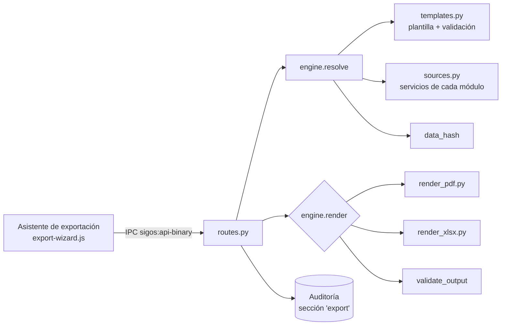

# Motor centralizado de exportaciones (PDF / XLSX)

> Estado: implementado el 17/11/2026 · Código: `services/api/app/exports/` · Cliente: `apps/desktop/src/renderer/export-wizard.js`
> Pruebas: `services/api/tests/test_exports.py` (44 tests)

## 1. Objetivo

Un único motor genera todos los documentos exportables de SIGOS a partir de **plantillas declarativas**. Ningún módulo
tiene su propio generador: los módulos solo aportan datos a través de una *fuente* que reutiliza sus servicios.

## 2. Arquitectura

| Capa (requisito) | Archivo | Responsabilidad |
|---|---|---|
| 1. Obtención y normalización | `sources.py` | Reutiliza `build_report`, `list_materials`, `list_requests_filtered`, `list_technicians`, `list_users`, `build_summary`, `get_expediente_status`. Devuelve **tipos reales** (int, float, Decimal, datetime). |
| 2. Selección de plantilla | `templates.py`, `engine.resolve` | Busca la plantilla, comprueba rol y formato compatible. |
| 3. Configuración | `engine.resolve` | Filtra parámetros permitidos, valida opciones `select`, columnas, orden y período. |
| 4. Render PDF | `render_pdf.py` | reportlab/platypus. |
| 5. Render XLSX | `render_xlsx.py` | openpyxl. |
| 6. Validación | `engine.validate_output` | PDF: cabecera `%PDF-`, `%%EOF`, ≥1 página. XLSX: se reabre y se cuentan las filas de la hoja Datos. |
| 7. Entrega | `routes.generate` | Respuesta binaria con nombre, filas y código de documento en cabeceras; registro en auditoría. |

Utilidades compartidas: `render_common.py` (formatos es-CO para vista previa y PDF, paleta institucional, alineación por tipo).

## 3. Plantillas

Cada plantilla (`templates.Template`) define: `id`, `name`, `description`, `module`, `source`, `columns` (clave, etiqueta,
tipo, peso de ancho, incluida por defecto), `formats`, `filters`, `sorts`, `default_sort/order`, `summary`, `group_by`,
`orientation`, `fixed_filters`, `allow_columns`, `roles` y `version`.

Tipos de columna: `text`, `int`, `number`, `money`, `percent`, `date`, `datetime`.

| Módulo | Id | Nombre | Agrupa | Notas |
|---|---|---|---|---|
| Materiales | `materials.inventory` | Inventario general | — | Filtros: estado de stock, categoría, búsqueda |
| | `materials.valued` | Inventario valorizado | — | Precio unitario y valor total (moneda) |
| | `materials.critical` | Existencias críticas | — | Solo `low` y `critical` (umbral de Configuración) |
| Órdenes | `orders.general` | Órdenes generales | — | Respeta la restricción por rol de `build_report` |
| | `orders.by_status` | Órdenes por estado | estado | |
| | `orders.by_period` | Órdenes por período | — | Fecha de referencia: creación o programación |
| Técnicos | `technicians.directory` | Directorio de técnicos | — | |
| | `technicians.assignments` | Asignaciones | — | Carga abierta por estado y completadas en el período |
| | `technicians.activity` | Actividad de técnicos | — | Basada en `HistorialEstadoOrden` |
| Solicitudes | `requests.general` | Solicitudes generales | — | Cantidades solicitada / aprobada / entregada |
| | `requests.pending` | Solicitudes pendientes | — | Antigüedad en días |
| | `requests.attended` | Solicitudes atendidas | — | Cumplimiento (entregado / solicitado) |
| Evidencias | `evidence.relation` | Relación de evidencias | — | |
| | `evidence.by_order` | Evidencias por orden | — | Conteo por momento, firma, estado del expediente |
| Reportes | `reports.kpis` | Resumen de indicadores | — | KPIs del Dashboard (7/14/30 días) |
| | `reports.operations` | Estadísticas operativas | dimensión | Estado, prioridad, zona, tipo de instalación |
| Usuarios | `users.directory` | Directorio de usuarios | — | **Solo admin**. Nunca incluye hash ni tokens |
| | `users.roles` | Distribución de roles y estados | — | **Solo admin** |

### Agregar una plantilla

1. Si los datos ya existen en una fuente, declarar la plantilla en `TEMPLATES` (columnas, filtros, resumen).
2. Si no, escribir `src_<nombre>(t, params, ctx)` en `sources.py` reutilizando el servicio del módulo y registrarla en `SOURCES`.
3. Opcional: resumen `sum_<nombre>(rows, params)` en `SUMMARIES`.
4. Ejecutar `pytest tests/test_exports.py`: la prueba parametrizada genera automáticamente la nueva plantilla en PDF y XLSX.

## 4. API

Todas requieren `admin` o `dispatcher` (además, cada plantilla declara sus `roles`).

| Método | Ruta | Descripción |
|---|---|---|
| GET | `/api/v1/exports/templates?module=&format=` | Catálogo filtrado por módulo, formato y rol |
| GET | `/api/v1/exports/options/<technicians\|categories>` | Opciones dinámicas de filtros |
| POST | `/api/v1/exports/preview` | `{template, format, params}` → primeras 15 filas formateadas, resumen, total, `hash` |
| POST | `/api/v1/exports/generate` | `{template, format, params, expected_hash?, accept_changes?}` → archivo |

`params` admite los filtros de la plantilla, `columns` (lista o CSV), `sort` y `order`.

Respuestas de error:

| Código | Cuándo | Cuerpo |
|---|---|---|
| 403 | Rol sin permiso para la plantilla | `{error}` |
| 409 | `expected_hash` no coincide con los datos actuales | `{error, code: "DATA_CHANGED", total, hash}` |
| 422 | Plantilla, formato, filtro, columna, orden, período o límite no válidos | `{error, code: "invalid_export", field}` |

Cabeceras de la respuesta de `generate`: `Content-Disposition`, `X-Export-Filename`, `X-Export-Rows`,
`X-Export-Document`, `Cache-Control: no-store`.

Compatibilidad: `GET /api/v1/reportes/ordenes?formato=pdf|xlsx` delega en `orders.general`.
`/materials/export*` (CSV y el modal antiguo de Materiales) se conserva sin cambios.

## 5. Documento PDF

- A4; horizontal si la tabla es ancha (suma de pesos > 9 o más de 7 columnas) o si la plantilla lo fija.
- Márgenes: 14 mm laterales, 30 mm superior (membrete), 16 mm inferior (pie).
- Membrete en cada página: marca, título, organización y módulo, código de documento, fecha y usuario.
- Pie: `SIGOS · <plantilla> v<versión>` y **«Página X de Y»** (`NumberedCanvas`).
- Tabla: encabezado repetido (`repeatRows=1`), filas nunca partidas (`splitInRow=0`), texto con salto de línea (`Paragraph`), bandas alternas.
- Agrupación: subtítulo por grupo con conteo; la columna de agrupación se omite en la tabla.
- Formatos: fechas `dd/mm/aaaa hh:mm`, miles con punto, moneda `$ 85.000`, porcentaje `20,0 %`.

## 6. Libro XLSX

- **Resumen**: membrete, «Registros exportados» con `COUNTA`, indicadores, totales `SUM` de magnitudes acumulables
  (nunca precios unitarios ni porcentajes) y distribución por grupo con `COUNTIF`.
- **Datos**: membrete en filas 1-3, encabezados en la fila 5, datos desde la 6 como **tabla estructurada** (filtros
  automáticos), paneles inmovilizados en `A6`, anchos calculados, ajuste de impresión a una página de ancho.
- Formatos: `#,##0`, `#,##0.00`, `"$" #,##0`, `0.0%`, `dd/mm/yyyy`, `dd/mm/yyyy hh:mm`. Las fechas se escriben en hora
  local de la organización y sin zona (Excel no la admite).
- Seguridad: todo texto se escribe con `data_type = "s"`; un valor como `=HYPERLINK(...)` queda como texto literal.

## 7. Asistente de exportación (desktop)

Botón **Exportar** en el header de: Dashboard y Reportes (`reports`), Órdenes, Técnicos, Materiales, Solicitudes,
Evidencias y Bandeja (`evidence`), Usuarios (solo admin). En Reportes y Usuarios se precargan los filtros de la pantalla.

1. **Formato** — PDF o XLSX.
2. **Plantilla** — solo las compatibles con el módulo, el formato y el rol.
3. **Configuración** — filtros, orden, columnas (si la plantilla lo permite); valida rango de fechas y al menos una columna.
4. **Vista previa** — encabezado del documento, resumen y primeras filas; avisa si se supera el límite de filas.
5. **Generar** — envía `expected_hash`; si los datos cambiaron, pregunta antes de generar con los datos actuales. Guarda
   con el diálogo nativo y muestra archivo, filas, código y tamaño, con «Abrir carpeta».

IPC: `window.sigos.apiBinary` (`sigos:api-binary`), restringido a rutas normalizadas `/api/v1/exports/` del mismo origen del API.

## 8. Seguridad y consistencia

- Permisos validados en backend en cada endpoint y por plantilla.
- Las fuentes reutilizan los servicios del módulo, con sus filtros y restricciones por rol.
- Sin datos sensibles: no hay columnas de contraseña, hash ni tokens; las columnas pedidas se validan contra la plantilla.
- Vista previa y generación usan el mismo `resolve`; el hash detecta cambios entre ambas (409 `DATA_CHANGED`).
- Límites: 5 000 filas en PDF y 50 000 en XLSX (422 con mensaje).
- Nombres de archivo: `sigos_<módulo>_<plantilla>_<AAAAMMDD-HHMM>.<ext>`; código de documento `SIGOS-<MOD>-<fecha>-<hora>-<hex>`.
- Auditoría: cada generación se registra en `Auditoria` (sección `export`): plantilla, versión, formato, filas, filtros,
  columnas, archivo, bytes, código de documento y si los datos cambiaron desde la vista previa.

## 9. Limitaciones conocidas

- **Actividad de técnicos** solo refleja cambios de estado registrados (no hay registro de horas).
- **Moneda**: solo los materiales tienen precio; las órdenes no tienen importes.
- **Evidencias por orden** calcula el estado del expediente orden por orden (costoso con miles de expedientes).
- Sin exportación **CSV** en el motor (sigue disponible solo en el modal antiguo de Materiales).
- Las fuentes cargan el conjunto completo en memoria antes de aplicar el límite de filas.
