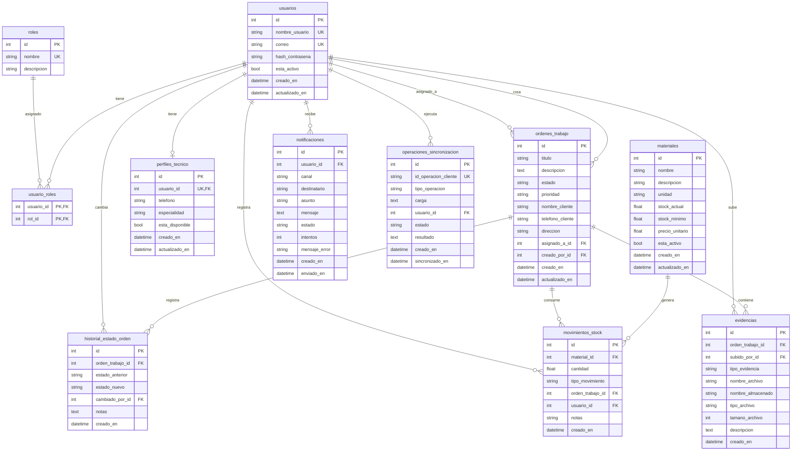

# Diseño de la base de datos — SIGOSV

Base de datos: Microsoft SQL Server. Esquema normalizado hasta 4FN. Los identificadores (tablas y columnas) se expresan en español.

## 1. Contexto

SIGOSV gestiona órdenes de servicio técnico: identidad/roles, asignación a técnicos, materiales y stock, evidencias, notificaciones y sincronización offline. El modelo final contiene 11 tablas.

## 2. Tabla inicial (resultado del levantamiento de información)

Tabla única desnormalizada `ORDEN_SERVICIO_COMPLETA` que concentra toda la información recogida, incluyendo grupos repetitivos (materiales, evidencias, roles, notificaciones, sincronización).

| Columna | Descripción |
|---|---|
| id_orden | Identificador de la orden |
| titulo | Título de la orden |
| descripcion | Descripción del trabajo |
| estado | Estado del flujo (pendiente, asignada, en_progreso, completada, cerrada, cancelada) |
| prioridad | Prioridad (baja, media, alta) |
| nombre_cliente | Nombre del cliente |
| telefono_cliente | Teléfono del cliente |
| direccion | Dirección del servicio |
| tecnico_id | Id del técnico asignado |
| tecnico_nombre | Nombre del técnico |
| tecnico_telefono | Teléfono del técnico |
| tecnico_especialidad | Especialidad del técnico |
| tecnico_disponible | Disponibilidad del técnico |
| creado_por_id | Id del usuario creador |
| creado_por_usuario | Usuario creador |
| creado_por_correo | Correo del creador |
| creado_en | Fecha de creación |
| actualizado_en | Fecha de actualización |
| material_nombre | Nombre del material |
| material_unidad | Unidad de medida |
| material_precio_unitario | Precio unitario |
| cantidad_usada | Cantidad consumida |
| tipo_movimiento | Tipo de movimiento (entrada, salida, consumo) |
| movimiento_fecha | Fecha del movimiento |
| movimiento_usuario | Usuario que registró el movimiento |
| evidencia_tipo | Tipo de evidencia (foto, documento, observación) |
| evidencia_archivo | Nombre del archivo |
| evidencia_tamano | Tamaño del archivo |
| evidencia_descripcion | Descripción de la evidencia |
| evidencia_fecha | Fecha de subida |
| evidencia_subida_por | Usuario que subió |
| notificacion_canal | Canal (correo, whatsapp) |
| notificacion_destinatario | Destinatario |
| notificacion_asunto | Asunto |
| notificacion_mensaje | Mensaje |
| notificacion_estado | Estado (pendiente, enviado, fallido) |
| notificacion_fecha | Fecha de envío |
| rol | Rol del usuario (admin, tecnico) |
| sinc_id_operacion | Id de operación de sincronización |
| sinc_tipo_operacion | Tipo de operación |
| sinc_carga | Payload JSON |
| sinc_estado | Estado de sincronización |
| sinc_sincronizado_en | Fecha de sincronización |

Problemas: valores multivaluados y grupos repetitivos (materiales por orden, evidencias, roles por usuario, notificaciones, operaciones de sync); dependencias parciales y transitivas.

## 3. Primera forma normal (1FN)

Se eliminan grupos repetitivos y se garantiza atomicidad. Cada hecho se separa en su propia tabla; se introduce clave primaria. Aún quedan redundancias (atributos transitivos y multivaluados).

Tablas en 1FN:

- `usuarios` (id, nombre_usuario, correo, hash_contrasena, esta_activo, creado_en, actualizado_en)
- `roles` (id, nombre, descripcion)
- `usuario_roles` (usuario_id, rol_id, rol_nombre)
- `ordenes_trabajo` (id, titulo, descripcion, estado, prioridad, nombre_cliente, telefono_cliente, direccion, tecnico_id, tecnico_nombre, tecnico_telefono, tecnico_especialidad, tecnico_disponible, creado_por_id, creado_por_usuario, creado_por_correo, creado_en, actualizado_en)
- `historial_estado_orden` (id, orden_id, estado_anterior, estado_nuevo, cambiado_por_id, cambiado_por_usuario, notas, fecha)
- `materiales` (id, nombre, descripcion, unidad, stock_actual, stock_minimo, precio_unitario, esta_activo, creado_en, actualizado_en)
- `movimientos_stock` (id, material_id, material_nombre, cantidad, tipo_movimiento, orden_id, usuario_id, usuario_nombre, notas, fecha)
- `perfiles_tecnico` (id, usuario_id, telefono, especialidad, disponible, creado_en, actualizado_en)
- `evidencias` (id, orden_id, tipo_evidencia, nombre_archivo, tamano_archivo, descripcion, fecha, subido_por_id, subido_por_nombre)
- `notificaciones` (id, usuario_id, usuario_nombre, canal, destinatario, asunto, mensaje, estado, fecha)
- `operaciones_sincronizacion` (id, id_operacion_cliente, tipo_operacion, carga, usuario_id, usuario_nombre, estado, fecha)

## 4. Segunda forma normal (2FN)

Se eliminan dependencias parciales respecto a claves compuestas. Los atributos que dependían solo de parte de una clave compuesta se separan (datos del técnico, del material, del usuario).

Tablas en 2FN:

- `usuarios` (id, nombre_usuario, correo, hash_contrasena, esta_activo, creado_en, actualizado_en)
- `roles` (id, nombre, descripcion)
- `usuario_roles` (usuario_id, rol_id)
- `perfiles_tecnico` (id, usuario_id, telefono, especialidad, esta_disponible, creado_en, actualizado_en)
- `ordenes_trabajo` (id, titulo, descripcion, estado, prioridad, nombre_cliente, telefono_cliente, direccion, asignado_a_id, creado_por_id, creado_en, actualizado_en)
- `historial_estado_orden` (id, orden_trabajo_id, estado_anterior, estado_nuevo, cambiado_por_id, notas, creado_en)
- `materiales` (id, nombre, descripcion, unidad, stock_actual, stock_minimo, precio_unitario, esta_activo, creado_en, actualizado_en)
- `movimientos_stock` (id, material_id, cantidad, tipo_movimiento, orden_trabajo_id, usuario_id, notas, creado_en)
- `evidencias` (id, orden_trabajo_id, subido_por_id, tipo_evidencia, nombre_archivo, nombre_almacenado, tipo_archivo, tamano_archivo, descripcion, creado_en)
- `notificaciones` (id, usuario_id, canal, destinatario, asunto, mensaje, estado, intentos, mensaje_error, creado_en, enviado_en)
- `operaciones_sincronizacion` (id, id_operacion_cliente, tipo_operacion, carga, usuario_id, estado, resultado, creado_en, sincronizado_en)

## 5. Tercera forma normal (3FN)

Se eliminan dependencias transitivas. Los datos del usuario creador y del técnico asignado no se almacenan en `ordenes_trabajo` (solo sus FK); los datos del material no se duplican en `movimientos_stock`; el estado del técnico no se deriva de la orden. Misma lista de tablas que 2FN, sin atributos redundantes.

## 6. Cuarta forma normal (4FN)

Se eliminan dependencias multivaluadas independientes. Un usuario puede tener varios roles y un rol varios usuarios → tabla `usuario_roles` (M:N). Los movimientos de stock son hechos independientes por material/orden/usuario. No existen dependencias multivaluadas residuales. Esquema final (11 tablas) del apartado 7.

## 7. Modelo entidad-relación

### 7.1 Diagrama (Mermaid)



### 7.2 Tablas relacionales (resumen)

| Tabla | PK | FK principales |
|---|---|---|
| usuarios | id | — |
| roles | id | — |
| usuario_roles | (usuario_id, rol_id) | usuario_id→usuarios.id, rol_id→roles.id |
| ordenes_trabajo | id | asignado_a_id→usuarios.id, creado_por_id→usuarios.id |
| historial_estado_orden | id | orden_trabajo_id→ordenes_trabajo.id, cambiado_por_id→usuarios.id |
| materiales | id | — |
| perfiles_tecnico | id | usuario_id→usuarios.id (UK) |
| movimientos_stock | id | material_id→materiales.id, orden_trabajo_id→ordenes_trabajo.id, usuario_id→usuarios.id |
| evidencias | id | orden_trabajo_id→ordenes_trabajo.id, subido_por_id→usuarios.id |
| notificaciones | id | usuario_id→usuarios.id |
| operaciones_sincronizacion | id | usuario_id→usuarios.id |

## 8. Diccionarios de datos

### usuarios
| Columna | Tipo | Nulo | Default | Restricciones | Descripción |
|---|---|---|---|---|---|
| id | int | No | identity | PK | Identificador |
| nombre_usuario | varchar(80) | No | — | UK, índice | Nombre de usuario |
| correo | varchar(120) | No | — | UK, índice | Correo electrónico |
| hash_contrasena | varchar(256) | No | — | — | Hash de contraseña |
| esta_activo | bit | No | 1 | — | Usuario activo |
| creado_en | datetime (tz) | Sí | now() | — | Fecha de creación |
| actualizado_en | datetime (tz) | Sí | now() | — | Fecha de actualización |

### roles
| Columna | Tipo | Nulo | Default | Restricciones | Descripción |
|---|---|---|---|---|---|
| id | int | No | identity | PK | Identificador |
| nombre | varchar(50) | No | — | UK, índice | Nombre del rol |
| descripcion | varchar(200) | Sí | — | — | Descripción |

### usuario_roles
| Columna | Tipo | Nulo | Default | Restricciones | Descripción |
|---|---|---|---|---|---|
| usuario_id | int | No | — | PK, FK→usuarios.id | Usuario |
| rol_id | int | No | — | PK, FK→roles.id | Rol |

### ordenes_trabajo
| Columna | Tipo | Nulo | Default | Restricciones | Descripción |
|---|---|---|---|---|---|
| id | int | No | identity | PK | Identificador |
| titulo | varchar(200) | No | — | — | Título |
| descripcion | text | Sí | — | — | Descripción |
| estado | varchar(20) | No | 'pendiente' | índice | Estado del flujo |
| prioridad | varchar(10) | No | 'media' | — | Prioridad |
| nombre_cliente | varchar(120) | Sí | — | — | Cliente |
| telefono_cliente | varchar(30) | Sí | — | — | Teléfono cliente |
| direccion | varchar(250) | Sí | — | — | Dirección |
| asignado_a_id | int | Sí | — | FK→usuarios.id | Técnico asignado |
| creado_por_id | int | No | — | FK→usuarios.id | Creador |
| creado_en | datetime (tz) | Sí | now() | — | Creación |
| actualizado_en | datetime (tz) | Sí | now() | — | Actualización |

### historial_estado_orden
| Columna | Tipo | Nulo | Default | Restricciones | Descripción |
|---|---|---|---|---|---|
| id | int | No | identity | PK | Identificador |
| orden_trabajo_id | int | No | — | FK→ordenes_trabajo.id, índice | Orden |
| estado_anterior | varchar(20) | No | — | — | Estado origen |
| estado_nuevo | varchar(20) | No | — | — | Estado destino |
| cambiado_por_id | int | No | — | FK→usuarios.id | Usuario que cambió |
| notas | text | Sí | — | — | Notas |
| creado_en | datetime (tz) | Sí | now() | — | Fecha del cambio |

### materiales
| Columna | Tipo | Nulo | Default | Restricciones | Descripción |
|---|---|---|---|---|---|
| id | int | No | identity | PK | Identificador |
| nombre | varchar(120) | No | — | índice | Nombre |
| descripcion | varchar(250) | Sí | — | — | Descripción |
| unidad | varchar(20) | No | — | — | Unidad de medida |
| stock_actual | float | No | 0 | — | Stock actual |
| stock_minimo | float | No | 0 | — | Stock mínimo |
| precio_unitario | float | No | 0 | — | Precio unitario |
| esta_activo | bit | No | 1 | — | Activo |
| creado_en | datetime (tz) | Sí | now() | — | Creación |
| actualizado_en | datetime (tz) | Sí | now() | — | Actualización |

### perfiles_tecnico
| Columna | Tipo | Nulo | Default | Restricciones | Descripción |
|---|---|---|---|---|---|
| id | int | No | identity | PK | Identificador |
| usuario_id | int | No | — | FK→usuarios.id, UK | Usuario técnico |
| telefono | varchar(30) | Sí | — | — | Teléfono |
| especialidad | varchar(80) | Sí | — | — | Especialidad |
| esta_disponible | bit | No | 1 | — | Disponible |
| creado_en | datetime (tz) | Sí | now() | — | Creación |
| actualizado_en | datetime (tz) | Sí | now() | — | Actualización |

### movimientos_stock
| Columna | Tipo | Nulo | Default | Restricciones | Descripción |
|---|---|---|---|---|---|
| id | int | No | identity | PK | Identificador |
| material_id | int | No | — | FK→materiales.id, índice | Material |
| cantidad | float | No | — | — | Cantidad |
| tipo_movimiento | varchar(15) | No | — | — | entrada/salida/consumo |
| orden_trabajo_id | int | Sí | — | FK→ordenes_trabajo.id | Orden asociada |
| usuario_id | int | No | — | FK→usuarios.id | Usuario |
| notas | varchar(250) | Sí | — | — | Notas |
| creado_en | datetime (tz) | Sí | now() | — | Fecha |

### evidencias
| Columna | Tipo | Nulo | Default | Restricciones | Descripción |
|---|---|---|---|---|---|
| id | int | No | identity | PK | Identificador |
| orden_trabajo_id | int | No | — | FK→ordenes_trabajo.id, índice | Orden |
| subido_por_id | int | No | — | FK→usuarios.id | Usuario que sube |
| tipo_evidencia | varchar(20) | No | — | — | foto/documento/observación |
| nombre_archivo | varchar(250) | Sí | — | — | Nombre original |
| nombre_almacenado | varchar(250) | Sí | — | — | Nombre en storage |
| tipo_archivo | varchar(50) | Sí | — | — | MIME type |
| tamano_archivo | int | Sí | — | — | Tamaño en bytes |
| descripcion | text | Sí | — | — | Descripción |
| creado_en | datetime (tz) | Sí | now() | — | Fecha |

### notificaciones
| Columna | Tipo | Nulo | Default | Restricciones | Descripción |
|---|---|---|---|---|---|
| id | int | No | identity | PK | Identificador |
| usuario_id | int | No | — | FK→usuarios.id, índice | Usuario |
| canal | varchar(15) | No | — | — | correo/whatsapp |
| destinatario | varchar(250) | No | — | — | Destinatario |
| asunto | varchar(200) | Sí | — | — | Asunto |
| mensaje | text | No | — | — | Mensaje |
| estado | varchar(15) | No | 'pendiente' | índice | Estado |
| intentos | int | No | 0 | — | Reintentos |
| mensaje_error | varchar(500) | Sí | — | — | Error |
| creado_en | datetime (tz) | Sí | now() | — | Creación |
| enviado_en | datetime (tz) | Sí | — | — | Envío |

### operaciones_sincronizacion
| Columna | Tipo | Nulo | Default | Restricciones | Descripción |
|---|---|---|---|---|---|
| id | int | No | identity | PK | Identificador |
| id_operacion_cliente | varchar(36) | No | — | UK, índice | Id cliente (UUID) |
| tipo_operacion | varchar(50) | No | — | — | Tipo |
| carga | text | No | — | — | Payload JSON |
| usuario_id | int | No | — | FK→usuarios.id | Usuario |
| estado | varchar(15) | No | 'pendiente' | índice | Estado |
| resultado | text | Sí | — | — | Resultado |
| creado_en | datetime (tz) | Sí | now() | — | Creación |
| sincronizado_en | datetime (tz) | Sí | — | — | Sincronización |

## 9. Índices

- usuarios: UK nombre_usuario, correo
- roles: UK nombre
- ordenes_trabajo: índice estado
- historial_estado_orden: índice orden_trabajo_id
- materiales: índice nombre
- movimientos_stock: índice material_id
- evidencias: índice orden_trabajo_id
- notificaciones: índice usuario_id, estado
- operaciones_sincronizacion: UK id_operacion_cliente, índice estado
- perfiles_tecnico: UK usuario_id

## 10. Correspondencia con la implementación actual (inglés)

| Diseño (español) | Implementación (inglés) |
|---|---|
| usuarios | users |
| roles | roles |
| usuario_roles | user_roles |
| ordenes_trabajo | work_orders |
| historial_estado_orden | work_order_status_history |
| materiales | materials |
| perfiles_tecnico | technician_profiles |
| movimientos_stock | stock_movements |
| evidencias | evidences |
| notificaciones | notifications |
| operaciones_sincronizacion | sync_operations |

## 11. Script de creación (SQL Server)

```sql
CREATE TABLE roles (
    id INT IDENTITY(1,1) PRIMARY KEY,
    nombre VARCHAR(50) NOT NULL UNIQUE,
    descripcion VARCHAR(200) NULL
);

CREATE TABLE usuarios (
    id INT IDENTITY(1,1) PRIMARY KEY,
    nombre_usuario VARCHAR(80) NOT NULL UNIQUE,
    correo VARCHAR(120) NOT NULL UNIQUE,
    hash_contrasena VARCHAR(256) NOT NULL,
    esta_activo BIT NOT NULL DEFAULT 1,
    creado_en DATETIMEOFFSET NULL DEFAULT SYSDATETIMEOFFSET(),
    actualizado_en DATETIMEOFFSET NULL DEFAULT SYSDATETIMEOFFSET()
);

CREATE TABLE usuario_roles (
    usuario_id INT NOT NULL,
    rol_id INT NOT NULL,
    PRIMARY KEY (usuario_id, rol_id),
    FOREIGN KEY (usuario_id) REFERENCES usuarios(id),
    FOREIGN KEY (rol_id) REFERENCES roles(id)
);

CREATE TABLE ordenes_trabajo (
    id INT IDENTITY(1,1) PRIMARY KEY,
    titulo VARCHAR(200) NOT NULL,
    descripcion NVARCHAR(MAX) NULL,
    estado VARCHAR(20) NOT NULL DEFAULT 'pendiente',
    prioridad VARCHAR(10) NOT NULL DEFAULT 'media',
    nombre_cliente VARCHAR(120) NULL,
    telefono_cliente VARCHAR(30) NULL,
    direccion VARCHAR(250) NULL,
    asignado_a_id INT NULL,
    creado_por_id INT NOT NULL,
    creado_en DATETIMEOFFSET NULL DEFAULT SYSDATETIMEOFFSET(),
    actualizado_en DATETIMEOFFSET NULL DEFAULT SYSDATETIMEOFFSET(),
    FOREIGN KEY (asignado_a_id) REFERENCES usuarios(id),
    FOREIGN KEY (creado_por_id) REFERENCES usuarios(id)
);
CREATE INDEX ix_ordenes_trabajo_estado ON ordenes_trabajo(estado);

CREATE TABLE historial_estado_orden (
    id INT IDENTITY(1,1) PRIMARY KEY,
    orden_trabajo_id INT NOT NULL,
    estado_anterior VARCHAR(20) NOT NULL,
    estado_nuevo VARCHAR(20) NOT NULL,
    cambiado_por_id INT NOT NULL,
    notas NVARCHAR(MAX) NULL,
    creado_en DATETIMEOFFSET NULL DEFAULT SYSDATETIMEOFFSET(),
    FOREIGN KEY (orden_trabajo_id) REFERENCES ordenes_trabajo(id),
    FOREIGN KEY (cambiado_por_id) REFERENCES usuarios(id)
);
CREATE INDEX ix_historial_estado_orden_orden ON historial_estado_orden(orden_trabajo_id);

CREATE TABLE materiales (
    id INT IDENTITY(1,1) PRIMARY KEY,
    nombre VARCHAR(120) NOT NULL,
    descripcion VARCHAR(250) NULL,
    unidad VARCHAR(20) NOT NULL,
    stock_actual FLOAT NOT NULL DEFAULT 0,
    stock_minimo FLOAT NOT NULL DEFAULT 0,
    precio_unitario FLOAT NOT NULL DEFAULT 0,
    esta_activo BIT NOT NULL DEFAULT 1,
    creado_en DATETIMEOFFSET NULL DEFAULT SYSDATETIMEOFFSET(),
    actualizado_en DATETIMEOFFSET NULL DEFAULT SYSDATETIMEOFFSET()
);
CREATE INDEX ix_materiales_nombre ON materiales(nombre);

CREATE TABLE perfiles_tecnico (
    id INT IDENTITY(1,1) PRIMARY KEY,
    usuario_id INT NOT NULL UNIQUE,
    telefono VARCHAR(30) NULL,
    especialidad VARCHAR(80) NULL,
    esta_disponible BIT NOT NULL DEFAULT 1,
    creado_en DATETIMEOFFSET NULL DEFAULT SYSDATETIMEOFFSET(),
    actualizado_en DATETIMEOFFSET NULL DEFAULT SYSDATETIMEOFFSET(),
    FOREIGN KEY (usuario_id) REFERENCES usuarios(id)
);

CREATE TABLE movimientos_stock (
    id INT IDENTITY(1,1) PRIMARY KEY,
    material_id INT NOT NULL,
    cantidad FLOAT NOT NULL,
    tipo_movimiento VARCHAR(15) NOT NULL,
    orden_trabajo_id INT NULL,
    usuario_id INT NOT NULL,
    notas VARCHAR(250) NULL,
    creado_en DATETIMEOFFSET NULL DEFAULT SYSDATETIMEOFFSET(),
    FOREIGN KEY (material_id) REFERENCES materiales(id),
    FOREIGN KEY (orden_trabajo_id) REFERENCES ordenes_trabajo(id),
    FOREIGN KEY (usuario_id) REFERENCES usuarios(id)
);
CREATE INDEX ix_movimientos_stock_material ON movimientos_stock(material_id);

CREATE TABLE evidencias (
    id INT IDENTITY(1,1) PRIMARY KEY,
    orden_trabajo_id INT NOT NULL,
    subido_por_id INT NOT NULL,
    tipo_evidencia VARCHAR(20) NOT NULL,
    nombre_archivo VARCHAR(250) NULL,
    nombre_almacenado VARCHAR(250) NULL,
    tipo_archivo VARCHAR(50) NULL,
    tamano_archivo INT NULL,
    descripcion NVARCHAR(MAX) NULL,
    creado_en DATETIMEOFFSET NULL DEFAULT SYSDATETIMEOFFSET(),
    FOREIGN KEY (orden_trabajo_id) REFERENCES ordenes_trabajo(id),
    FOREIGN KEY (subido_por_id) REFERENCES usuarios(id)
);
CREATE INDEX ix_evidencias_orden ON evidencias(orden_trabajo_id);

CREATE TABLE notificaciones (
    id INT IDENTITY(1,1) PRIMARY KEY,
    usuario_id INT NOT NULL,
    canal VARCHAR(15) NOT NULL,
    destinatario VARCHAR(250) NOT NULL,
    asunto VARCHAR(200) NULL,
    mensaje NVARCHAR(MAX) NOT NULL,
    estado VARCHAR(15) NOT NULL DEFAULT 'pendiente',
    intentos INT NOT NULL DEFAULT 0,
    mensaje_error VARCHAR(500) NULL,
    creado_en DATETIMEOFFSET NULL DEFAULT SYSDATETIMEOFFSET(),
    enviado_en DATETIMEOFFSET NULL,
    FOREIGN KEY (usuario_id) REFERENCES usuarios(id)
);
CREATE INDEX ix_notificaciones_usuario ON notificaciones(usuario_id);
CREATE INDEX ix_notificaciones_estado ON notificaciones(estado);

CREATE TABLE operaciones_sincronizacion (
    id INT IDENTITY(1,1) PRIMARY KEY,
    id_operacion_cliente VARCHAR(36) NOT NULL UNIQUE,
    tipo_operacion VARCHAR(50) NOT NULL,
    carga NVARCHAR(MAX) NOT NULL,
    usuario_id INT NOT NULL,
    estado VARCHAR(15) NOT NULL DEFAULT 'pendiente',
    resultado NVARCHAR(MAX) NULL,
    creado_en DATETIMEOFFSET NULL DEFAULT SYSDATETIMEOFFSET(),
    sincronizado_en DATETIMEOFFSET NULL,
    FOREIGN KEY (usuario_id) REFERENCES usuarios(id)
);
CREATE INDEX ix_operaciones_sincronizacion_estado ON operaciones_sincronizacion(estado);
```

## Catálogos geográficos (país ? ciudad ? zona)

países, ciudades (DIVIPOLA), zonas; cobertura técnico; integridad normalizada.

