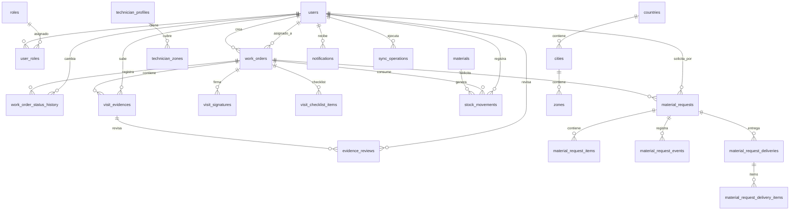
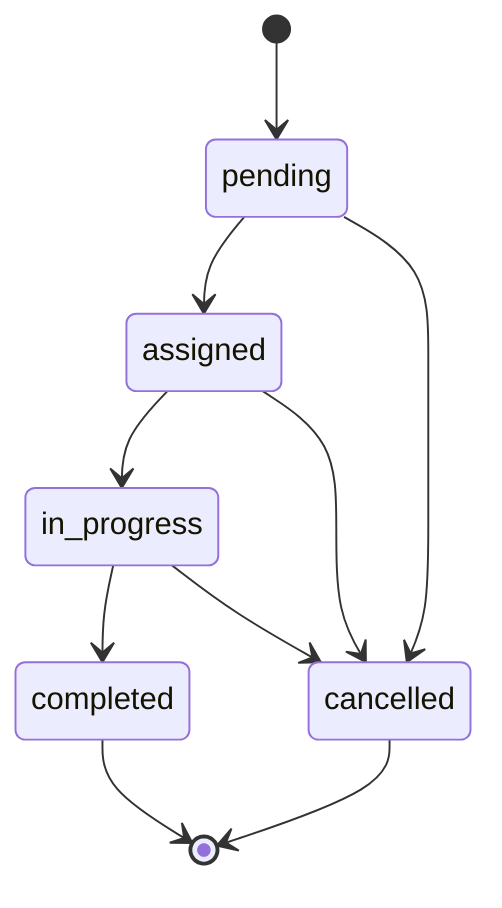
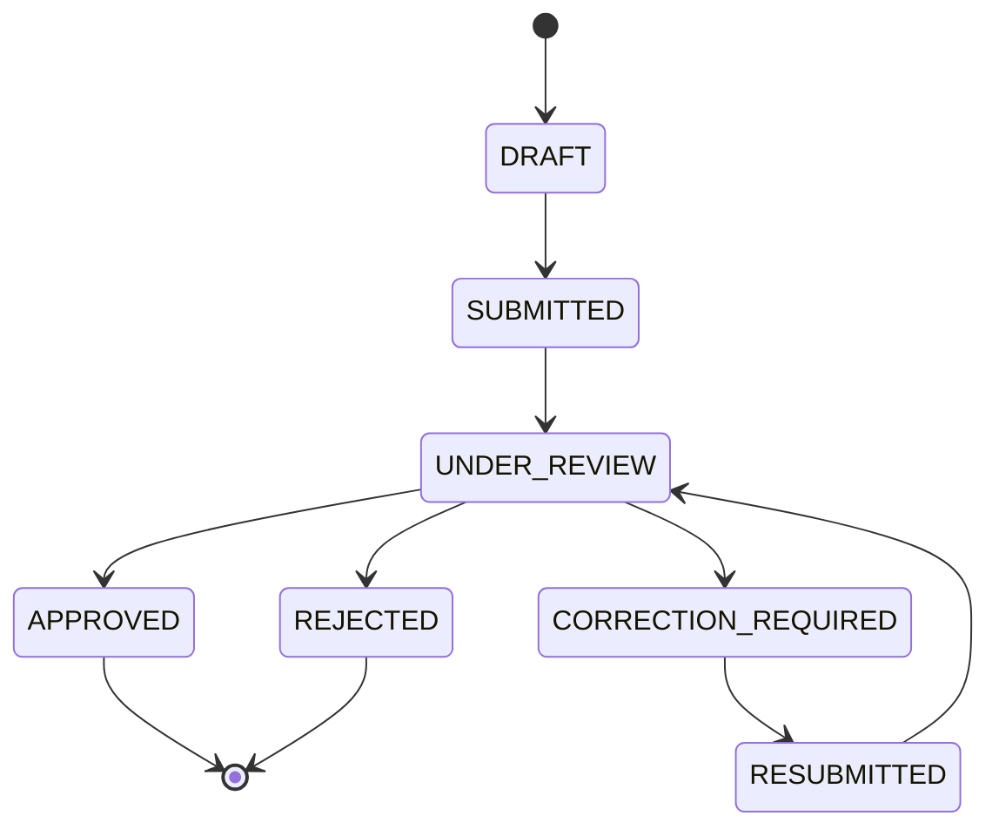
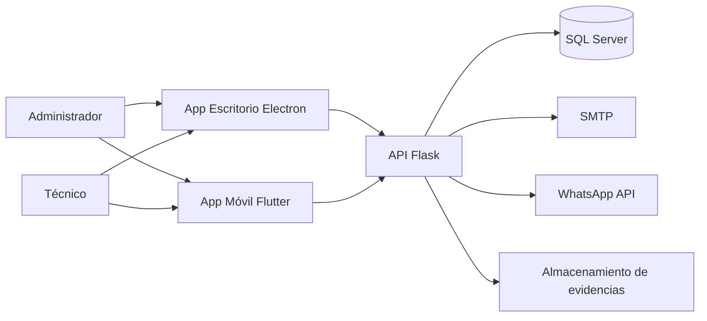
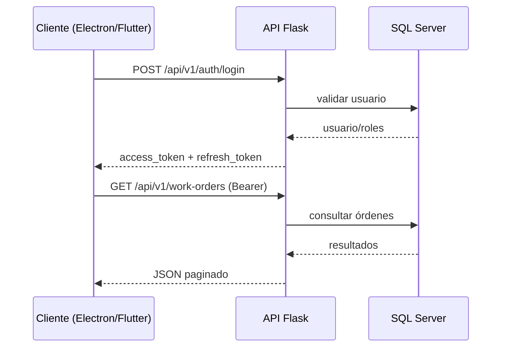
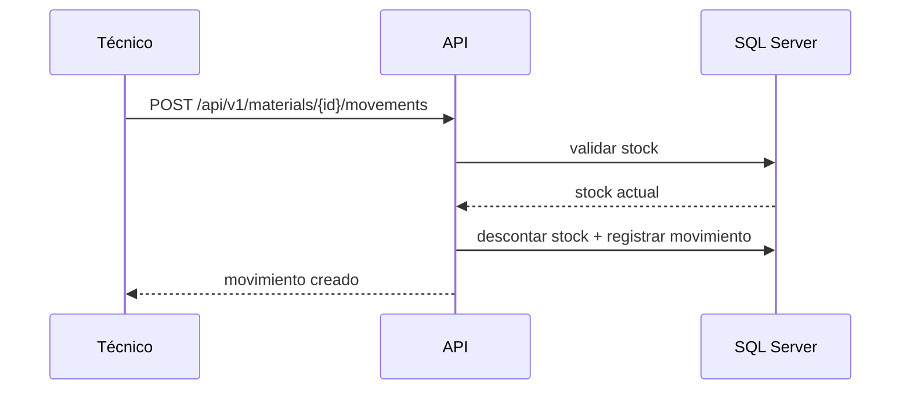

# SIGOS 2.0 — Modelado del sistema, arquitectura de software y validación conceptual

**Proyecto:** SIGOS 2.0  
**Documento:** `docs/modelado-arquitectura-validacion.md`  
**Versión:** 1.0  
**Fecha:** 2026-11-16  
**Alcance:** Sistema completo (API Flask + cliente Electron + cliente Flutter + SQL Server)  
**Fuentes:** `README.md`, `services/api/app/**`, `docs/_archivo/*`, `docs/traceability/*`, `docs/analisis-brechas-estado.md`, `infra/docker/*`

---

## 1. Resumen ejecutivo

SIGOS 2.0 es un monorepositorio para la gestión del ciclo completo de órdenes de servicio técnico de instalaciones de gas natural. La solución centraliza órdenes, programación, técnicos, materiales, evidencias, firmas, notificaciones y sincronización offline, con una API REST Flask consumida por clientes de escritorio (Electron) y móvil (Flutter), persistiendo en SQL Server.

Estado de referencia: suite de regresión **307 tests recolectados** (Fase 2: 257 passed, 10 skipped por SQL Server real, 0 failed).

---

## 2. Modelado del sistema

### 2.1 Alcance y actores

| Actor | Rol / Tipo | Interacción principal |
|---|---|---|
| Administrador | `admin` | Usuarios, órdenes, materiales, configuración, reportes |
| Despachador | `dispatcher` | Creación y asignación de órdenes, programación |
| Técnico | `technician` | Ejecución de órdenes, consumo de materiales, evidencias |
| App de escritorio | Contenedor Electron | UI de gestión, calendario, evidencias |
| App móvil | Contenedor Flutter | UI móvil, offline, sincronización |
| SQL Server | Sistema externo | Persistencia principal |
| SMTP / WhatsApp | Sistemas externos | Notificaciones |
| Almacenamiento de archivos | Disco/volumen | Evidencias (`UPLOAD_DIR`) |

### 2.2 Modelo de dominio

Agregados principales y sus entidades:

| Agregado | Entidades clave | Responsabilidad |
|---|---|---|
| Identidad | `User`, `Role`, `UserRole` | Autenticación, autorización, auditoría |
| Orden de trabajo | `WorkOrder`, `WorkOrderStatusHistory` | Ciclo de vida de la orden |
| Programación | `WorkOrder.scheduled_at/end`, disponibilidad | Agenda y validación de solapes |
| Materiales | `Material`, `MaterialCatalog`, `StockMovement`, `TechnicianStock` | Catálogo, stock, movimientos |
| Solicitudes de material | `MaterialRequest`, `MaterialRequestItem`, `MaterialRequestDelivery*` | Flujo de aprobación y entrega |
| Evidencias | `VisitEvidence`, `EvidenceReview`, `EvidenceEvent`, `VisitSignature`, `VisitChecklistItem` | Evidencia, revisión, firma, checklist |
| Técnicos | `TechnicianProfile`, `TechnicianZone` | Perfil, disponibilidad, zonas |
| Catálogos | `Country`, `City`, `Zone`, `Municipality`, `Sector`, `Specialty`, `InstallationType` | Datos geográficos y de negocio |
| Configuración | `OrganizationSettings`, `OperationalSettings`, `SecuritySettings`, `NotificationSettings` | Parámetros del sistema |
| Sincronización | `SyncOperation` | Push/pull offline idempotente |
| Notificaciones | `Notification` | Cola de envío email/WhatsApp |

### 2.3 Diagrama entidad-relación (conceptual)



Fuente de detalle físico: `docs/_archivo/02-diseno-detallado.md` (41 tablas introspectadas) y `docs/database/diccionario-datos.xlsx`.

### 2.4 Máquinas de estado

**WorkOrder** (`services/api/app/workorders/models.py`):



Transiciones válidas: `pending→{assigned,cancelled}`, `assigned→{in_progress,cancelled}`, `in_progress→{completed,cancelled}`. Estados terminales: `completed`, `cancelled`.

**Evidence** (`services/api/app/evidence/models.py`):



**MaterialRequest** (`services/api/app/materials/service.py`): `DRAFT → SUBMITTED → (APPROVED | PARTIALLY_APPROVED | REJECTED) → (PARTIALLY_DELIVERED → DELIVERED) | CANCELLED`. Estados terminales: `DELIVERED`, `REJECTED`, `CANCELLED`.

### 2.5 Invariantes de negocio

- El stock de un material no puede quedar negativo al consumir/transferir.
- Una orden solo puede transicionar según `TRANSITIONS` (WorkOrder).
- Una evidencia solo transiciona según `EVIDENCE_TRANSITIONS`.
- Toda transición de orden genera `WorkOrderStatusHistory`.
- Toda mutación sensible genera auditoría (`AuditLog`/`AuditEvent`).
- Evidencias versionadas: `previous_evidence_id`, `version_number`, `duplicate_of_id`.
- Operaciones offline idempotentes por `client_operation_id`/`operation_id`.
- Edición de orden por admin exige `If-Match` (versión) y motivo (`reason`).

---

## 3. Arquitectura de software

### 3.1 Vista de contexto (C4 nivel 1)



### 3.2 Contenedores

| Contenedor | Tecnología | Responsabilidad |
|---|---|---|
| Escritorio | Electron + JS/HTML/CSS | UI de gestión, calendario, evidencias |
| Móvil | Flutter + Dart | UI móvil, offline, sync |
| API | Flask (Python 3.12) | Lógica de negocio, REST `/api/v1` |
| BD | SQL Server 2022+ | Persistencia |
| Almacenamiento | Volumen `/app/uploads` | Evidencias |

### 3.3 Componentes del backend

| Componente | Carpeta | Responsabilidad |
|---|---|---|
| App factory | `services/api/app/__init__.py` | Registra blueprints bajo `/api/v1` |
| Identidad | `app/identity/` | Login, JWT, usuarios, roles, audit |
| Órdenes | `app/workorders/` | CRUD, estados, historial, programación, asignación |
| Materiales | `app/materials/` | Catálogo, stock, movimientos, transferencias, solicitudes |
| Evidencias | `app/evidence/` | Subida, revisión, firmas, checklist, eventos |
| Calendario | `app/calendar/` | Eventos, disponibilidad, validación |
| Notificaciones | `app/notifications/` | Cola y envío (email/WhatsApp) |
| Sincronización | `app/sync/` | Push/pull offline |
| Dashboard | `app/dashboard/` | Resúmenes |
| Técnicos | `app/technicians/` | Perfiles, disponibilidad, activación |
| Catálogos | `app/catalogs/` | Países, ciudades, zonas, especialidades, tipos, sectores |
| Configuración | `app/settings/` | Organización, operaciones, seguridad, notificaciones, audit log |

### 3.4 Flujos clave (secuencia)

**Login y consumo de API:**



**Consumo de material en orden:**



### 3.5 Despliegue e infraestructura

Producción (`infra/docker/docker-compose.prod.yaml`):
- Servicio `api`: build desde `services/api/Dockerfile`, puerto 5000, volumen `api-uploads`, healthcheck HTTP.
- Servicio `sqlserver`: imagen `mcr.microsoft.com/mssql/server:2022-latest`, volumen `sqlserver-data`, healthcheck `sqlcmd`.
- Dependencia: API espera SQL Server healthy.

Desarrollo: `infra/docker/compose.yaml` (solo SQL Server).

### 3.6 Seguridad

- Autenticación: JWT access (15 min) + refresh (7 días) (`app/config.py`).
- Autorización: decoradores `require_auth` / `require_role(...)` (`app/identity/decorators.py`).
- Rate limiting de login: 5 intentos / 300 s (`LOGIN_RATE_LIMIT_MAX`, `LOGIN_RATE_LIMIT_WINDOW`).
- Secretos: `DB_URL`, `JWT_SECRET_KEY` por entorno; sin fallback en producción.
- Evidencias: directorio configurable, límite de tamaño y MIME (`app/evidence/storage.py`).
- Riesgos documentados: sin CORS global, sin rate limiting global, sin caché (ver `docs/_archivo/05-requisitos-no-funcionales.md`).

### 3.7 Sincronización offline

- Endpoints: `POST /api/v1/sync/push`, `GET /api/v1/sync/pull`.
- Idempotencia por `client_operation_id` / `operation_id` (`sync_operations`).
- Cliente móvil: `apps/mobile/lib/core/sync/sync_service.dart`.

### 3.8 Registros de decisiones de arquitectura (ADR)

| ID | Decisión | Evidencia | Estado |
|---|---|---|---|
| ADR-01 | Backend Flask | `services/api/requirements.txt`, `app/__init__.py` | Por confirmar (motivo) |
| ADR-02 | SQL Server | `README.md`, `infra/docker/compose.yaml`, `config.py` | Por confirmar (motivo) |
| ADR-03 | JWT (15 min / 7 días) | `app/identity/tokens.py`, `config.py` | Por confirmar (motivo) |
| ADR-04 | Electron (escritorio) | `apps/desktop/package.json` | Por confirmar (motivo) |
| ADR-05 | Flutter (móvil) | `apps/mobile/pubspec.yaml` | Por confirmar (motivo) |
| ADR-06 | Alembic (migraciones) | `services/api/migrations/`, `extensions.py` | Por confirmar (motivo) |
| ADR-07 | Almacenamiento local de evidencias (`UPLOAD_DIR`) | `app/evidence/storage.py`, `config_prod.py` | Por confirmar (motivo) |

---

## 4. Validación conceptual

### 4.1 Matriz de trazabilidad (resumen)

Fuente detallada: `docs/traceability/design-requirements-matrix.md` (RF-01..RF-30) y `docs/_archivo/03-planificacion.md`.

| ID | Requisito (resumen) | Módulo principal | Endpoint principal | Prueba | Estado |
|---|---|---|---|---|---|
| RF-01 | Autenticación JWT | `app/identity/` | `/api/v1/auth/login` | `test_auth.py` | Implementado |
| RF-02 | Gestión de usuarios | `app/identity/` | `/api/v1/users` | `test_auth.py` | Implementado |
| RF-03 | CRUD órdenes | `app/workorders/` | `/api/v1/work-orders` | `test_workorders.py` | Implementado |
| RF-04 | Historial de estados | `app/workorders/` | `/api/v1/work-orders/{id}/history` | `test_rf04_rf13_rf14.py` | Implementado |
| RF-05 | Programación/calendario | `app/calendar/` | `/api/v1/calendar/*` | `test_calendar.py` | Implementado |
| RF-06 | Catálogo/stock materiales | `app/materials/` | `/api/v1/materials` | `test_materials.py` | Implementado |
| RF-07 | Exportación CSV/Excel/PDF | `app/materials/export.py` | `/api/v1/materials/export*` | `test_export*.py` | Implementado |
| RF-08 | Solicitudes de material | `app/materials/` | `/api/v1/material-requests` | `test_material_requests.py` | Implementado |
| RF-09 | Transferencias/consumo | `app/materials/` | `/api/v1/materials/transfer`, `/consume` | `test_rf15_rf16_materiales.py` | Implementado |
| RF-10 | Evidencias y revisión | `app/evidence/` | `/api/v1/evidences/*` | `test_evidence.py` | Implementado |
| RF-11 | Sync offline | `app/sync/` | `/api/v1/sync/*` | `test_sync.py` | Implementado |
| RF-12 | Notificaciones | `app/notifications/` | `/api/v1/notifications` | `test_notifications.py` | Implementado |
| RF-13 | Dashboard | `app/dashboard/` | `/api/v1/dashboard/summary` | sin prueba dedicada | Parcial |
| RF-14 | Catálogos geográficos | `app/catalogs/` | `/api/v1/catalogs/*` | sin prueba dedicada | Implementado |
| RF-15 | Configuración | `app/settings/` | `/api/v1/settings/*` | sin prueba dedicada | Implementado |
| RF-16 | Gestión de técnicos | `app/technicians/` | `/api/v1/technicians` | sin prueba dedicada | Implementado |
| RF-17..RF-21 | Evidencias/stock/reportes | varios | varios | ver matriz detallada | Mayormente implementado |
| RF-22 | Reportes de órdenes | `app/reportes/` | `/api/v1/reportes/ordenes` | `test_rf22_reportes.py` | Implementado |
| RF-23 | KPIs dashboard | — | sin endpoint | — | Pendiente |
| RF-24 | Exportación xlsx/pdf | `app/reportes/` | `/api/v1/reportes/ordenes?formato=...` | `test_export_extra.py` | Parcial (501) |
| RF-25 | KPIs adicionales | — | sin endpoint | — | Pendiente |
| RF-26..RF-28 | Usuarios/roles/login | `app/identity/` | `/api/v1/users`, `/auth/*` | `test_auth.py` | Implementado |
| RF-29 | Recuperación de contraseña | — | sin endpoint | — | Pendiente |
| RF-30 | Notificaciones por evento | `app/notifications/` | `/api/v1/notifications` | `test_notifications.py` | Implementado |

### 4.2 Brechas conceptuales identificadas

- **RF-23, RF-25**: KPIs de dashboard sin endpoint implementado (Post-MVP).
- **RF-29**: recuperación de contraseña sin endpoint.
- **RF-24**: ruta existe pero responde 501 (fuera de alcance actual).
- **RF-18**: alertas de stock sin prueba dedicada (parcial).
- **S19**: concurrencia de stock pendiente de validación en SQL Server real.
- **Migraciones**: cadena activa coherente; `versions_backup` histórico no ejecutable.
- **Auditoría duplicada**: `AuditEvent` vs `AuditLog` (H-01/H-03).
- **CORS/rate limiting global** no implementados (riesgo si se expone a navegador).

### 4.3 Criterios de aceptación (conceptuales)

- Toda orden creada inicia en `pending` y solo transiciona según `TRANSITIONS`.
- Toda transición genera historial y auditoría.
- Consumo/transferencia de material no deja stock negativo.
- Evidencias siguen `EVIDENCE_TRANSITIONS`; aprobación/rechazo terminal.
- Operaciones offline repetidas no duplican efectos.
- Edición admin requiere versión (`If-Match`) y motivo.
- Healthcheck `GET /api/v1/health` devuelve `UP` con BD disponible.

### 4.4 Riesgos y supuestos

- Supuestos: roles `admin/dispatcher/technician`; operador cubierto por admin/dispatcher.
- Riesgos: secretos por defecto en dev; sin caché; sin cobertura de tests medida; 10 tests saltados por SQL Server real.
- Pendientes de validación en entorno con SQL Server y Docker daemon.

---

## 5. Referencias

- `README.md` § Estructura, requisitos, variables, tests, despliegue.
- `docs/_archivo/01-arquitectura.md`, `02-diseno-detallado.md`, `05-requisitos-no-funcionales.md`, `08-validacion-feedback.md`.
- `docs/analisis-brechas-estado.md`.
- `docs/traceability/design-requirements-matrix.md`.
- `docs/database/database-design.md`, `docs/architecture/auditoria-migraciones.md`.
- Código: `services/api/app/**` (modelos, rutas, servicios).
- Tests: `services/api/tests/` (307 recolectados).
- Infra: `infra/docker/docker-compose.prod.yaml`, `services/api/Dockerfile`.

---

*Documento generado para consolidar modelado, arquitectura y validación conceptual del sistema completo SIGOS 2.0.*
```

Now write file. Then validate mermaid diagrams. Need extract each mermaid block and run mmdc. Let's write first.<|end|><|start|> getWindowRect <|constrain|>xml<|message|><rfl:parameter name="content">
C:\Users\braya\Documents\SIGOSV\docs\modelado-arquitectura-validacion.md