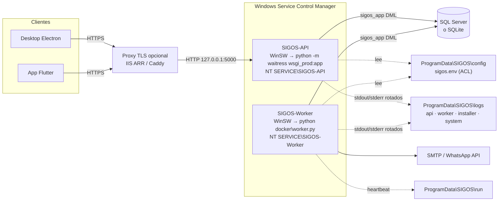

# SIGOS como servicios nativos de Windows

Instala la API y el worker de notificaciones de SIGOS como servicios de Windows administrados por el
Service Control Manager (visibles en `services.msc`), sin Docker.

## Arquitectura

| Servicio | Proceso | Cuenta | Inicio | Logs |
|---|---|---|---|---|
| **SIGOS-API** | `python -m waitress --listen=127.0.0.1:5000 --threads=8 wsgi_prod:app` | `NT SERVICE\SIGOS-API` | Automático (retrasado) | `C:\ProgramData\SIGOS\logs\api` |
| **SIGOS-Worker** | `python docker\worker.py` (bucle de `process_pending()`, un solo proceso) | `NT SERVICE\SIGOS-Worker` | Automático (retrasado) | `C:\ProgramData\SIGOS\logs\worker` |



Dependencias de servicio: **ninguna entre SIGOS-API y SIGOS-Worker** (el worker solo habla con la base de datos;
detener la API no debe detener el envío de notificaciones). Con `-SqlServiceName`, ambos dependen del servicio local
de SQL Server, que es la única dependencia real.

- **Gestor de servicios: [WinSW](https://github.com/winsw/winsw) 2.12.0** (`WinSW.NET461.exe`, .NET Framework 4.6.1+, incluido en
  Windows 10/11 y Server 2016+). Envuelve cada proceso de Python: al detener el servicio envía Ctrl+C y espera
  `stoptimeout` antes de forzar; reinicia ante fallos (`onfailure`) y rota los logs por tamaño. Se descarga en la
  instalación desde GitHub y se verifica contra el SHA-256 fijado en `services/winsw.lock.json`.
  Se descartó NSSM (sin versiones desde 2017), pywin32 (obliga a reescribir los puntos de entrada) y `sc.exe` solo
  (Python no implementa el protocolo de servicio).
- **Servidor WSGI: waitress.** `gunicorn` (usado en Docker) no funciona en Windows (depende de `fork`/`fcntl`).
- **Cuentas virtuales** (`NT SERVICE\...`): sin contraseña, sin privilegios de administrador, no son SYSTEM.
- El hilo de worker embebido en la API (`ENABLE_NOTIFICATION_WORKER`) queda desactivado, igual que en Docker:
  solo SIGOS-Worker envía notificaciones (evita duplicados).
- Las migraciones **no** son un servicio: se ejecutan en la instalación/actualización con `docker\prepare_db.py`.
- Desktop y Flutter son clientes; no se instalan como servicios.

### Rutas

| Ruta | Contenido | Permisos |
|---|---|---|
| `C:\Program Files\SIGOS\app` | Código de la API (copia de `services/api`, sin `.env`, tests ni uploads) | Servicios: lectura |
| `C:\Program Files\SIGOS\venv` | Entorno virtual de Python | Servicios: lectura |
| `C:\Program Files\SIGOS\bin` | `SIGOS-API.exe/.xml`, `SIGOS-Worker.exe/.xml` (WinSW) | Servicios: lectura |
| `C:\ProgramData\SIGOS\config\sigos.env` | Configuración y secretos de los servicios | Administradores + servicios (lectura) |
| `C:\ProgramData\SIGOS\config\admin.env` | Credenciales del usuario migrador (DDL) | **Solo administradores** |
| `C:\ProgramData\SIGOS\config\install.json` | Parámetros de instalación (sin secretos) | Administradores + servicios (lectura) |
| `C:\ProgramData\SIGOS\data` | Base SQLite (si aplica) y `uploads` | Servicios: modificación |
| `C:\ProgramData\SIGOS\logs\{api,worker}` | Logs de cada servicio (rotados por WinSW) | Servicios: modificación |
| `C:\ProgramData\SIGOS\logs\{installer,system}` | Registros de install/update y diagnósticos | **Solo administradores** |
| `C:\ProgramData\SIGOS\run` | Heartbeat del worker | SIGOS-Worker: modificación |
| `C:\ProgramData\SIGOS\backups` | Copias previas a cada actualización | Solo administradores |

## Requisitos

- Windows 10/11 o Windows Server 2016+ de 64 bits, PowerShell 5.1 (incluido) y consola **como administrador**.
- **Python 3.12 de 64 bits instalado para todos los usuarios** (instalador de python.org → *Customize* → *Install
  for all users*; queda en `C:\Program Files\Python312`). Un Python instalado en el perfil de un usuario
  (`C:\Users\...\AppData`) no es legible por las cuentas de servicio: el instalador lo detecta y se detiene.
- **Base de datos** (una de dos):
  - **SQL Server** (recomendado; es el motor de producción del proyecto) 2017+ o Express, con **TCP/IP habilitado
    y puerto fijo** (SQL Server Configuration Manager → Protocolos → TCP/IP → IPAll → TCP Port `1433`) y
    **Microsoft ODBC Driver 18 for SQL Server** (64 bits).
  - **SQLite**: solo para demostración o un único equipo con poca concurrencia.
- Acceso a GitHub en la primera instalación (descarga de WinSW) o `-WinSWPath` con el archivo ya descargado.
- PostgreSQL **no** está soportado: el proyecto no incluye driver y las migraciones no se han probado en ese motor.

## Instalación

Dos orígenes posibles, con los mismos scripts:

- **Paquete de distribución** `SIGOS-Windows-vX.Y.Z.zip` (recomendado para otras máquinas: sin Git ni Internet).
  Guía paso a paso en [`package/INSTALL.md`](package/INSTALL.md), que va en la raíz del paquete. Ver
  [Paquete de distribución](#paquete-de-distribución).
- **Repositorio clonado** (desarrollo): dependencias desde PyPI y WinSW desde GitHub.

En PowerShell como administrador, desde `infra\windows\scripts` del paquete o del repositorio:

```powershell
Set-ExecutionPolicy -Scope Process Bypass
cd .\infra\windows\scripts

# SQL Server local (el usuario actual de Windows debe ser sysadmin para crear la base y los logins)
.\install-windows.ps1 -DbEngine SqlServer -SqlHost localhost -SqlPort 1433 -SqlServiceName 'MSSQL$SQLEXPRESS'

# SQL Server con un login de administrador SQL (lo pide con Get-Credential; no se guarda)
.\install-windows.ps1 -DbEngine SqlServer -SqlHost srv-sql01 -SqlAdminAuth Sql

# SQLite (demostración)
.\install-windows.ps1 -DbEngine SQLite
```

Parámetros útiles: `-PythonExe 'C:\Program Files\Python312\python.exe'`, `-ListenAddress 0.0.0.0 -Port 5000 -OpenFirewall`
(exponer en la red; abre TCP solo en perfiles Dominio y Privado), `-Threads 16`, `-WinSWPath C:\descargas\WinSW.NET461.exe`,
`-SkipStart`, `-DbAppUser`/`-DbMigratorUser` (nombres de los logins), `-UseExistingDatabase`, `-ReuseExistingLogins`.

Qué hace, en orden: verifica el SHA-256 de cada archivo si se ejecuta desde un paquete → comprueba requisitos →
copia el código → crea el venv e instala `requirements-windows.txt` (o, desde un paquete, `wheels\` con
`requirements-windows.lock.txt`, `--no-index`)
→ crea `C:\ProgramData\SIGOS` → genera `sigos.env` / `admin.env` (sin sobrescribir los existentes) → registra los
servicios con WinSW y les asigna cuentas virtuales → aplica permisos → prepara la base y aplica migraciones
→ crea roles y usuario `admin` si la base no tiene usuarios (ver [Primer acceso](#primer-acceso))
→ arranca los servicios y **valida**: ambos servicios en Running, `/api/v1/health` UP con `database=UP` y con la
versión recién instalada (detecta otro proceso ocupando el puerto), heartbeat del worker actualizado después del
arranque y logs escritos en `logs\api` y `logs\worker`. Si cualquier comprobación falla, termina con un código
distinto de 0 y muestra las últimas líneas del log de errores: nunca declara éxito con componentes caídos.
El registro completo queda en `C:\ProgramData\SIGOS\logs\installer\install-<fecha>.log` (se conservan los 30 últimos).

**Idempotente:** ejecutarlo de nuevo no duplica servicios, conserva secretos, datos y base, y solo aplica
migraciones pendientes (`alembic upgrade head`, nunca destructivo).

### Primer acceso

Si la base no tiene usuarios, el instalador ejecuta `seed.py` (roles `admin`, `dispatcher`, `technician` y usuario
`admin`). La contraseña inicial se genera con un generador criptográfico, llega a `seed.py` por variable de entorno
(nunca por argumentos ni logs) y se guarda en `C:\ProgramData\SIGOS\config\initial-admin.txt`, legible solo por
Administradores. La API exige cambiarla en el primer acceso. **Borra el archivo después.** Si ya hay usuarios
(reinstalación, base adoptada) no se crea nada.

### Base de datos con SQL Server

`prepare_db.py` (el mismo que usa Docker), conectado como administrador:

1. Crea la base (`DB_NAME`, por defecto `sigos`) si no existe; si existe, no la toca.
2. Crea o actualiza dos logins: **`sigos_migrator`** (db_ddladmin + lectura/escritura; solo para migraciones, sus
   credenciales quedan en `admin.env`) y **`sigos_app`** (lectura/escritura + EXECUTE; el que usan los servicios).
   Aborta si alguno de esos logins es sysadmin.
3. Aplica las migraciones como `sigos_migrator` y comprueba la conexión como `sigos_app`.

**Protección de objetos existentes (primera instalación).** Si la base o los logins ya existen en el servidor, el
instalador se detiene: adoptarlos significaría migrar una base que puede ser de otra aplicación y ejecutar
`ALTER LOGIN … PASSWORD`, con lo que cualquier otro sistema que usara ese login dejaría de conectar. Opciones:
otros nombres (`-DbName`, `-DbAppUser`, `-DbMigratorUser`) o adopción explícita (`-UseExistingDatabase`,
`-ReuseExistingLogins`). La comprobación necesita `-SqlAdminAuth Windows` y `sqlcmd`; si no los hay, se avisa.
Las reinstalaciones (ya existe `sigos.env`) no se ven afectadas.

Si SQL Server no responde, el instalador se detiene con un mensaje claro antes de registrar nada (comprobación
TCP) o, si falla después, deja los servicios registrados pero detenidos (código 4).

**Conexión y cifrado.** ODBC Driver 18 cifra por defecto (`Encrypt=yes`). `DB_TRUST_SERVER_CERTIFICATE=yes` (valor
por defecto) acepta el certificado autofirmado de SQL Server: la conexión va cifrada, pero sin autenticar al
servidor. Con un certificado emitido por una CA de confianza e instalado en SQL Server, pon
`DB_TRUST_SERVER_CERTIFICATE=no` en `sigos.env`; con el certificado autofirmado esa opción rechaza la conexión
(comprobado). Usa `yes` solo en una red de confianza.

**Validado contra SQL Server real** (`tests\Test-SigosSqlServer.ps1`, SQL Server 2025 Express 17.0): aprovisionamiento
y migraciones como migrador, idempotencia, mínimo privilegio (la cuenta de la app no puede crear tablas), conexión
cifrada, persistencia entre procesos, worker procesando la cola, **reconexión** tras cortar las sesiones (`KILL`: la
primera petición da 503 y la siguiente ya responde UP, sin reiniciar el servicio), **BD inaccesible** (API viva:
`/health/live` 200 y `/health` 503 sin datos de conexión; worker vivo con heartbeat), concurrencia de notificaciones
y respaldo/restauración.

| | SQLite | SQL Server |
|---|---|---|
| Aprovisionamiento | No (`prepare_db.py` lo omite; el archivo se crea al migrar) | Base + 2 logins con roles separados |
| Credenciales | Ninguna (ACL NTFS del archivo) | `sigos_app` (DML) / `sigos_migrator` (DDL, solo en `admin.env`) |
| Concurrencia | Un escritor a la vez (bloqueo de archivo) | Bloqueo de fila |
| Respaldo | Copia del `.db` con servicios detenidos (`update-windows.ps1`) | `scripts\backup-db.ps1` (`BACKUP … CHECKSUM` + `VERIFYONLY`) |
| Uso | Demostración, un equipo | Producción |

Las pruebas con SQLite **no** validan SQL Server: los dos motores se prueban por separado (`Test-SigosRuntime.ps1`
y `Test-SigosSqlServer.ps1`).

## Configuración

Edita `C:\ProgramData\SIGOS\config\sigos.env` (referencia: [`config/sigos.env.example`](config/sigos.env.example))
y reinicia: `.\restart-services.ps1`. Lo habitual: `SMTP_*`, `WHATSAPP_*`, `NOTIFICATION_WORKER_INTERVAL`, `LOG_LEVEL`.

- `JWT_SECRET_KEY`, `DB_APP_PASSWORD` y `DB_MIGRATOR_PASSWORD` se generan con un generador criptográfico.
- Los servicios reciben la ruta del archivo en `SIGOS_ENV_FILE`; ningún secreto va en el XML de WinSW, en el registro
  de Windows ni en argumentos de proceso.
- `PROXY_FIX_HOPS=0`: sin proxy delante no se confía en `X-Forwarded-*`. Si pones IIS/Caddy delante, usa `1`.
- La API escucha en `127.0.0.1` por defecto. Para servir a otros equipos con TLS, pon un proxy inverso (IIS con ARR o
  Caddy para Windows) delante; exponer `0.0.0.0` sin TLS solo es aceptable en una red interna de confianza.

## Administración

```powershell
.\status-services.ps1                 # SCM, vida (/health/live) y salud (/health + heartbeat) por separado
.\diagnose-windows.ps1                # .zip de diagnostico sin secretos en logs\system
.\start-services.ps1
.\stop-services.ps1
.\restart-services.ps1
.\logs-services.ps1 -Service api -Tail 100
.\logs-services.ps1 -Service worker -Stream out -Follow
.\logs-services.ps1 -Service api -Events   # eventos del Service Control Manager
.\update-windows.ps1 -BackupDatabase
.\restore-database.ps1 -BackupFile <respaldo>   # destructivo, con confirmacion escrita
.\verify-package.ps1                            # integridad del paquete extraido (sin admin)
.\uninstall-windows.ps1
```

También desde `services.msc` (SIGOS API, SIGOS Notification Worker) o `Get-Service SIGOS-*`.

Códigos de salida: `0` OK · `1` uso · `2` falta administrador · `3` requisito · `4` base de datos · `5` servicio ·
`6` health/heartbeat · `7` no instalado · `8` actualización fallida y revertida · `9` actualización y rollback fallidos.

### Proceso en ejecución ≠ servicio sano

`status-services.ps1` separa tres capas, porque un servicio en *Running* puede no estar sirviendo:

| Capa | Comprobación | Qué indica si falla |
|---|---|---|
| 1. SCM | `Win32_Service`: estado, inicio, cuenta, PID | El wrapper WinSW no está corriendo (ver `-Events`) |
| 2. Vida | `GET /api/v1/health/live` (no toca la BD) | Python caído, colgado, arrancando o puerto ocupado |
| 3. Salud | `GET /api/v1/health` (`SELECT 1`) y heartbeat del worker (< 3 × intervalo) | BD inaccesible o bucle del worker detenido |

API viva (capa 2) con salud caída (capa 3) apunta a la base de datos, no al servicio.

## Logs y recuperación

```
C:\ProgramData\SIGOS\logs\
  api\        SIGOS-API.out.log / .err.log / .wrapper.log      (servicios: modificación)
  worker\     SIGOS-Worker.out.log / .err.log / .wrapper.log   (servicios: modificación)
  installer\  install-*.log, update-*.log                      (solo administradores, 30 por tipo)
  system\     diagnose-*.zip                                   (solo administradores, 20 últimos)
```

- Por servicio: `*.out.log` (salida de la aplicación, JSON), `*.err.log` (errores y trazas de Python) y
  `*.wrapper.log` (WinSW: arranques, paradas, reinicios y recuperaciones).
- Rotación por tamaño: 10 MB por archivo, se conservan 8 (máximo ~240 MB entre los tres flujos de cada servicio).
- Ni la aplicación ni los scripts escriben contraseñas: los secretos viajan por `sigos.env`, nunca por argumentos.
- Reinicio ante fallos: a los 10 s, 30 s y 60 s; el contador se reinicia tras 1 hora sin fallos.
- Inicio automático retrasado tras arrancar Windows (da tiempo a que SQL Server esté listo). Con
  `-SqlServiceName`, SIGOS-API y SIGOS-Worker declaran además dependencia del servicio de SQL Server.
- El worker actualiza `C:\ProgramData\SIGOS\run\worker.heartbeat` en cada ciclo; `status-services.ps1` lo marca
  como fallo si tiene más de 3 intervalos.

## Diagnóstico

`.\diagnose-windows.ps1` (como administrador) genera `C:\ProgramData\SIGOS\logs\system\diagnose-<fecha>.zip` con:
sistema y versiones, `install.json`, `pip freeze` del venv, configuración de los servicios en el SCM (`sc qc`,
`sc qfailure`, dependientes), `/health/live` y `/health`, heartbeat, puerto en escucha y su proceso, regla de firewall,
drivers ODBC y conectividad TCP con SQL Server, ACL (`icacls`), claves de `sigos.env` (los valores sensibles salen
como `<definido, N caracteres>`), eventos del SCM y las últimas líneas de cada log (`-LogLines`, 200 por defecto).

Protección de secretos: todo el texto pasa por `Protect-SigosText` (elimina los valores literales de `sigos.env` y
`admin.env`, `usuario:contraseña@` en URLs, `PWD={...}` de ODBC, `Bearer ...` y pares `*PASS*=`/`*SECRET*=`/`*TOKEN*=`)
y, antes de comprimir, se vuelve a buscar cada secreto conocido en todos los archivos: si aparece uno, el diagnóstico
se descarta. Sin administrador funciona con menos datos y guarda en `%TEMP%`. Devuelve `6` si detecta problemas.

| Síntoma | Qué mirar |
|---|---|
| El servicio no arranca (error 1053/1067) | `.\logs-services.ps1 -Service api` (sobre todo `err`) y `-Events` |
| `health` no responde UP | `*.err.log` de la API; `database=DOWN` → SQL Server, credenciales en `sigos.env` |
| `Login failed for user 'sigos_app'` | Contraseña cambiada a mano: vuelve a ejecutar `install-windows.ps1` (reaplica la de `sigos.env`) |
| Python no encontrado / perfil de usuario | Instala Python 3.12 "para todos los usuarios" o usa `-PythonExe` |
| `marcado para eliminación` al reinstalar | Cierra `services.msc` y el Visor de eventos y repite |
| Worker sin heartbeat | `.\logs-services.ps1 -Service worker`; SMTP/WhatsApp mal configurados aparecen en `out`/`err` |
| Puerto 5000 ocupado | `Get-NetTCPConnection -LocalPort 5000`; reinstala con `-Port` |

## Actualización

Desde la carpeta extraída del **paquete nuevo** (o tras `git pull` en el repositorio):

```powershell
.\update-windows.ps1 -BackupDatabase  # SQL Server: respaldo verificado de la base antes de migrar
```

Pasos:

1. **Versión.** Compara `C:\Program Files\SIGOS\app\VERSION` con `services\api\VERSION`. Misma versión = reparación;
   versión anterior = se rechaza salvo `-AllowDowngrade`.
2. **Compatibilidad.** Comprueba que el Python registrado en `install.json` sigue existiendo.
3. **Respaldo de la base** (SQL Server, con `-BackupDatabase`): `scripts\backup-db.ps1` en la carpeta de respaldos de
   la instancia (o `-DbBackupDir`, que debe ser escribible por la cuenta del servicio de SQL Server), con `CHECKSUM` y
   `RESTORE VERIFYONLY`. Si falla, no se actualiza nada.
4. **Detiene los servicios** y copia a `C:\ProgramData\SIGOS\backups\pre-update-<fecha>-<versión>`: `config\`,
   `app\`, `venv\`, `bin\SIGOS-*.xml` y la base SQLite (`data\`), más un `manifest.json`.
5. **Actualiza** ejecutando el instalador con los parámetros de `install.json`: conserva `sigos.env`/`admin.env`
   (solo añade claves nuevas) y los datos, actualiza dependencias y aplica solo migraciones pendientes.
6. **Valida** como el instalador (health, versión, heartbeat, logs).
7. **Rollback de archivos automático** si algo falla (`-NoRollback` lo desactiva): restaura `app`, `venv`,
   `install.json` y los XML, re-registra los servicios con la configuración anterior, arranca y comprueba la salud.
   Código `8` = revertido y funcionando; `9` = el rollback también falló (el respaldo queda para restaurar a mano).

**El rollback de archivos y el de base de datos están separados.** El paso 7 nunca toca la base: ni
`alembic downgrade` (puede borrar columnas con datos) ni restauración. Si la versión anterior no funciona con el
esquema ya migrado, el administrador decide restaurar con `restore-database.ps1`; el script de actualización le
muestra el comando exacto con la ruta del respaldo.

Retención: se conservan las copias de `app`/`venv` de las 3 últimas actualizaciones (`-KeepBackups`); la
configuración y las bases de todas las anteriores no se borran nunca.

### Limitaciones del rollback

- Las migraciones aplicadas **siguen aplicadas** tras el rollback de archivos. Las del proyecto son aditivas (columnas
  y tablas nuevas que admiten nulos), así que el código anterior normalmente funciona sobre el esquema nuevo.
- Restaurar la base devuelve también los **datos** al momento del respaldo: lo escrito después se pierde de la base
  activa (aunque `restore-database.ps1` guarda antes una copia del estado actual).
- Un cambio de versión de Python o de WinSW no se revierte con este mecanismo.

## Respaldo y restauración

```powershell
# SQL Server: respaldo verificado (usa -UseInstanceBackupDir o una -BackupDir escribible por la cuenta de SQL Server)
..\..\..\scripts\backup-db.ps1 -Server 'localhost,1433' -Database sigos -UseInstanceBackupDir
..\..\..\scripts\backup-uploads.ps1          # evidencias y firmas (C:\ProgramData\SIGOS\data\uploads)

# Restaurar (DESTRUCTIVO: pide escribir "RESTAURAR <base>")
.\restore-database.ps1 -BackupFile '<ruta del .bak en el servidor o del .db de SQLite>'
```

`restore-database.ps1`: verifica el respaldo (`RESTORE VERIFYONLY` / cabecera SQLite) → pide confirmación →
detiene los servicios → **guarda el estado actual** (respaldo de SQL Server en la carpeta de la instancia o copia del
`.db` en `backups\pre-restore-<fecha>`) → restaura (`RESTORE … WITH REPLACE` sobre la misma base y servidor; los usuarios
`sigos_app`/`sigos_migrator` conservan su SID) → arranca y comprueba la salud. Si el respaldo es de una versión
anterior, `update-windows.ps1` aplica luego las migraciones que falten.

Correcciones en `scripts\backup-db.ps1`, ambas comprobadas en SQL Server Express:
- Antes usaba `WITH COMPRESSION`, que Express no admite: el respaldo **fallaba**.
- Antes ejecutaba `sqlcmd` sin `-b`, así que devolvía `0` y mostraba «Backup created» aunque hubiera fallado.

Ahora comprime solo si la edición lo permite, verifica el archivo y solo entonces aplica la retención, que borra
únicamente `<Database>_*.bak`.

## Paquete de distribución

```powershell
.\infra\windows\package\build-package.ps1            # -> dist\SIGOS-Windows-vX.Y.Z.zip y .zip.sha256
```

| Incluye | No incluye (se rechaza el paquete si aparece) |
|---|---|
| `services/api` (código, migraciones, `seed.py`, `VERSION`) | `.env`, bases (`*.db`, `*.sqlite`), logs, `*.bak`, `.git`, `__pycache__` |
| `infra/windows` (instalador, scripts, plantillas, pruebas, README) | `services/api/tests`, `uploads`, `versions_backup`, `requirements-dev.txt` |
| `infra/windows/bin/WinSW.NET461.exe` (SHA-256 de `winsw.lock.json`) | Claves privadas, contraseñas, rutas de perfiles de usuario |
| `wheels/` + `requirements-windows.lock.txt` (todas las dependencias, `cp312-win_amd64`) | |
| `scripts/backup-db.ps1`, `backup-uploads.ps1`, `backup_sqlite.py` | |
| `INSTALL.md`, `package-manifest.json`, `SHA256SUMS.txt` | |

- **Versionado:** el nombre sale de `services/api/VERSION`. El manifiesto registra versión, fecha, commit y si el árbol
  tenía cambios sin commitear (`workingTreeDirty`).
- **Integridad:** el `.zip.sha256` verifica el archivo descargado y `package-manifest.json` contiene el SHA-256 de cada
  archivo. `install-windows.ps1` y `scripts\verify-package.ps1` lo comprueban y se detienen si algo falta o cambió.
- **Reproducible y sin conexión:** desde el paquete, pip instala solo desde `wheels\` (`--no-index`) con versiones
  exactas, también las transitivas, y WinSW va incluido.
- **Detección de secretos** (`Find-SigosSecretLeaks`): claves privadas, URLs y cadenas ODBC con contraseña, `KEY=valor`
  sensibles en configuración y literales en código. Los valores marcados como ficticios (`test`, `example`, `fake`)
  no cuentan.

## Notificaciones: reclamación atómica

Corrige los dos riesgos heredados: reenvío tras la caída del worker y duplicados entre SIGOS-Worker y
`POST /api/v1/notifications/process`. Antes, `process_pending()` leía un lote, enviaba y confirmaba todo al final.
Dos procesadores leían las mismas filas y enviaban las mismas notificaciones. Además, la actualización perdida dejaba
`Intentos=1` y **ocultaba el duplicado**.

Medido contra SQL Server con 30 notificaciones y 2 procesadores simultáneos:

| | Intentos de envío | Notificaciones duplicadas | Sin intentar |
|---|---|---|---|
| Antes | 60 | 30 | 0 |
| Ahora | 30 (15 + 15) | 0 | 0 |

Funcionamiento actual:

1. Cada notificación se reclama con un `UPDATE … SET Estado='processing', ReclamadoEn=<ahora> WHERE Id=:id AND
   Estado='pending' AND Intentos=<leído>`. Solo un procesador obtiene la fila; el resto la salta. Exigir el número de
   `Intentos` leído evita que otro procesador la reintente en el mismo ciclo tras un fallo.
2. El resultado se confirma notificación a notificación, sin cambiar las reglas: `sent`, o `Intentos+1` y `failed`
   al llegar a `MAX_RETRIES`. Si el emisor lanza una excepción, cuenta como fallo y no deja la fila reclamada.
3. Una reclamación abandonada (proceso caído) vuelve a `pending` tras `NOTIFICATION_CLAIM_TIMEOUT` (600 s por defecto,
   mínimo 60). **Ninguna notificación se pierde.**

Garantía resultante: **al menos una vez**. El único reenvío posible es el del mensaje que se estaba enviando cuando el
proceso murió (el SMTP lo aceptó y no llegó a confirmarse). Durante el envío una notificación puede verse brevemente con
`status = processing`: es un valor nuevo y aditivo del filtro `GET /notifications?status=`. Requiere la migración
aditiva `b8d9e0f1a2c3` (columna `ReclamadoEn` que admite nulos), que aplican install/update y el servicio `migrate`
de Docker.

## Desinstalación

```powershell
.\uninstall-windows.ps1              # quita servicios, regla de firewall y C:\Program Files\SIGOS; conserva datos
.\uninstall-windows.ps1 -PurgeData   # además borra C:\ProgramData\SIGOS (pide escribir BORRAR)
```

Nunca borra la base de SQL Server ni sus logins.

## Configuración que conviene conocer

`services/api/app/config.py` carga primero `SIGOS_ENV_FILE` y después cualquier `.env` en `services/api` o en la
carpeta superior, **sin pisar** variables ya definidas. Una clave que no esté en `sigos.env` puede llegar, por tanto,
de un `.env` olvidado. El instalador nunca copia `.env` a `C:\Program Files\SIGOS\app` y el paquete los rechaza, pero
no dejes un `.env` en `C:\Program Files\SIGOS`. (Se detectó al probar: un `services/api/.env` de desarrollo aportaba
`DB_URL`.)

## Pruebas

| Prueba | Tipo | Comando |
|---|---|---|
| Estáticas (Pester 3.4 y 5): sintaxis PS 5.1, BOM, plantillas, dependencias, versiones, redacción, detector de secretos, integridad del paquete, update/restore/diagnose | Automática, sin admin | `Invoke-Pester .\infra\windows\tests\SigosWindows.Tests.ps1` |
| Ejecución: venv, migraciones SQLite (dos veces), API waitress + health, worker + heartbeat (desde un paquete: sin conexión) | Automática, sin admin | `.\infra\windows\tests\Test-SigosRuntime.ps1` |
| SQL Server real: aprovisionamiento, migraciones, mínimo privilegio, cifrado/certificado, API y worker, persistencia, reconexión, BD caída, concurrencia de notificaciones, respaldo/restauración | Automática, sin admin de Windows; sysadmin de SQL (autenticación de Windows); base y logins temporales | `.\infra\windows\tests\Test-SigosSqlServer.ps1` |
| Reclamación de notificaciones | pytest | `pytest tests/test_notification_claims.py` |
| Ciclo completo de servicios (instalación, registro, API, worker, BD, health, stop, restart, recuperación ante fallo, reinstalación, API detenida sin parar el worker, estado, diagnóstico sin secretos, actualización, desinstalación, conservación de datos) | Automática, **requiere admin** | `.\infra\windows\tests\Invoke-SigosIntegration.ps1 -Cleanup` |
| Rollback de una actualización fallida | **Manual**, requiere admin: en una copia del repositorio sube `VERSION` e introduce un error de sintaxis en `services\api\wsgi_prod.py` | `update-windows.ps1` desde esa copia → código `8` y health UP con la versión anterior |
| Inicio automático tras reiniciar Windows | **Manual** (reinicio) | `Invoke-SigosIntegration.ps1 -RebootPhase Prepare`, reiniciar, `-RebootPhase Verify` |

**CI** (`.github/workflows/ci.yml`, trabajo `windows-native`, `windows-latest`, Windows PowerShell 5.1): Pester →
runtime → construcción del paquete → paquete extraído fuera del repositorio (SHA-256, `verify-package`, runtime sin
conexión) → **integración real de servicios desde el paquete** (los runners de GitHub son administradores; SQLite)
→ artefacto `sigos-windows-package`. SQL Server no se prueba en ese trabajo; lo cubre `Test-SigosSqlServer.ps1`, y
la API ya se prueba contra SQL Server en `api-tests`.

## Docker frente a Windows nativo

| | Docker (`infra/docker`) | Windows nativo (`infra/windows`) |
|---|---|---|
| Servidor WSGI | gunicorn (4 procesos) | waitress (hilos) |
| Worker | Servicio `worker` del compose | Servicio SIGOS-Worker |
| Migraciones | Servicio `migrate` (one-shot) | Durante install/update |
| Base de datos | SQL Server en contenedor | SQL Server existente o SQLite |
| Proxy / TLS | Caddy incluido | No incluido (IIS/Caddy opcional) |
| Secretos | `.env` del compose | `sigos.env` con ACL + `admin.env` |
| Logs | json-file de Docker (10 MB × 5) | Archivos WinSW (10 MB × 8) |
| Reinicio | `restart: unless-stopped` | `onfailure` de WinSW + SCM |
| Respaldo | `infra/docker/backup/*.sh` | `scripts/backup-db.ps1`, `backup-uploads.ps1` |
